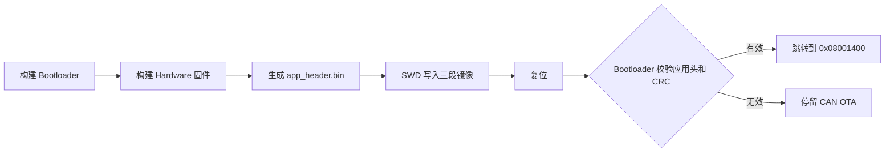

# Flex LoVo BMS

Flex LoVo BMS 是面向 STM32F103C8T6 + BQ76940 的低压电池管理系统工程。
仓库包含 Zephyr 应用固件、裸机 CAN Bootloader、Python 上位机、Renode
虚拟测试平台、场景数据和板级事实资料。当前实物配置按 9 串电芯处理，
BQ76940 的有效采样槽位为 `VC1、VC2、VC5、VC6、VC7、VC10、VC11、VC12、VC15`。

> 本工程仍处于开发与验证阶段，不应未经硬件保护验证直接用于量产或无人值守的
> 高能量电池包。首次上电、阈值修改和 OTA 测试应配合限流电源、熔断保护和独立
> 电压/温度监测。

## 工程组成

| 目录 | 内容 | 入口文档 |
|---|---|---|
| [`firmware/`](firmware/) | Zephyr BMS 主应用、驱动、算法和任务 | [固件说明](firmware/README.md) |
| [`bootloader/`](bootloader/) | STM32F103 裸机 CAN Bootloader 与 OTA 工具 | [Bootloader 说明](bootloader/README.md) |
| [`host/python/`](host/python/) | Python UART 实时界面和 Renode 虚拟上位机 | [上位机说明](host/README.md) |
| [`tests/`](tests/) | Renode 平台、回归脚本和电池场景 | [测试说明](tests/README.md) |
| [`docs/board-facts/`](docs/board-facts/) | 引脚、AFE 参数、CAN 字段和板级事实 | [板级资料](docs/board-facts/README.md) |

Qt 上位机计划放在 `host/qt/`，当前发布版本先提供 Python 方案。

## 运行环境

本工程当前开发环境使用 Windows PowerShell。下面的版本是已验证参考值，不是硬编码
限制；换版本后应重新执行完整构建和 Renode 回归。

| 工具 | 已验证版本 | 用途 |
|---|---:|---|
| Python | 3.13.5 | west、上位机和 OTA 工具 |
| Zephyr | 4.4.99 开发树 | 固件 RTOS、设备模型和构建系统 |
| xPack GNU Arm Embedded GCC | 15.2.1-1.1 | 固件与 Bootloader 交叉编译 |
| Renode | 1.16.0.6726 | STM32F103/BQ76940 虚拟验证 |
| Git | 2.50.0.windows.1 | 版本管理 |
| GNU Make | 任一兼容版本 | 构建裸机 Bootloader |

## 首次配置

### 1. 获取仓库

```powershell
git clone https://github.com/MosyuSora/Flex_LoVo_BMS.git
Set-Location Flex_LoVo_BMS
```

### 2. 准备 Zephyr 工作区

如果还没有 Zephyr 工作区，可在仓库外创建。已有工作区可直接跳到环境变量配置。

```powershell
python -m pip install --upgrade pip west
west init C:\zephyr-workspace
Set-Location C:\zephyr-workspace
west update
west zephyr-export
python -m pip install -r .\zephyr\scripts\requirements.txt
```

回到仓库根目录后，指定 Zephyr 与 ARM GCC。路径只对当前 PowerShell 会话生效，
不需要修改全局配置。

```powershell
$env:ZEPHYR_BASE = "C:\zephyr-workspace\zephyr"
$env:GNUARMEMB_TOOLCHAIN_PATH = "C:\Tools\xpack-arm-none-eabi-gcc-15.2.1-1.1"
```

也可以使用不纳入 Git 的 `Tools/` 目录。脚本先检查仓库根目录，再检查仓库的
同级目录，因此以下两种布局都可以使用：

```text
Flex_LoVo_BMS/Tools/
父目录/Tools/
├── zephyr-workspace/zephyr/
└── arm-gcc/xpack-arm-none-eabi-gcc-15.2.1-1.1/
```

### 3. 安装 Renode 和 Python 依赖

安装 Renode 后，默认路径应为 `C:\Program Files\Renode\bin\Renode.exe`。安装在
其他位置时设置：

```powershell
$env:BMS_RENODE_PATH = "D:\Tools\Renode\bin\Renode.exe"
python -m pip install -r .\host\python\requirements.txt
python -m pip install -r .\bootloader\tools\requirements.txt
```

## 构建流程

### 仿真固件

```powershell
.\firmware\build.ps1
```

默认构建面向 Renode：HSI 8 MHz、无 UART DMA，输出位于
`firmware/build/zephyr/`。主要产物是 `zephyr.elf`、`zephyr.hex` 和 `zephyr.bin`。

### 真机固件

```powershell
.\firmware\build.ps1 -Hardware
```

真机构建叠加 HSE 8 MHz → PLL 72 MHz、UART DMA 和
`CONFIG_FLASH_LOAD_OFFSET=0x1400`，输出位于 `firmware/build_hw/zephyr/`。
该镜像设计为由本仓库 Bootloader 启动，不能当作地址 `0x08000000` 的独立应用烧录。

### Bootloader

```powershell
Set-Location .\bootloader
make GNUARMEMB_TOOLCHAIN_PATH=C:/Tools/xpack-arm-none-eabi-gcc-15.2.1-1.1
Set-Location ..
```

Windows 只安装了 Qt/MinGW 时，把 `make` 换成 `mingw32-make`。

输出为 `bootloader.elf`、`bootloader.bin` 和 `bootloader.hex`。完整 Flash 布局、首次
SWD 烧录和 OTA 方法见 [Bootloader README](bootloader/README.md)。

## 首次烧录与启动

首次装机需要一次 SWD 烧录：Bootloader 写入 `0x08000000`，应用头写入
`0x08001000`，真机应用写入 `0x08001400`。后续版本更新可走 CAN OTA。



生成首次应用头：

```powershell
python .\bootloader\tools\header_gen.py `
    .\firmware\build_hw\zephyr\zephyr.bin 1 .\bootloader\app_header.bin
```

具体 `STM32_Programmer_CLI` 命令见
[首次 SWD 烧录](bootloader/README.md#首次-swd-烧录)。

## 运行与验证流程

推荐按以下顺序验证一次完整工程：

```powershell
# 1. Python 协议解析单元测试
python -m unittest discover -s .\host\python -p "test_*.py"

# 2. 固件构建 + normal/overvoltage/balance 等 Renode 场景
.\tests\renode\run_zephyr_bms_smoke.ps1

# 3. UART 命令、看门狗和调度压力回归
.\tests\renode\run_zephyr_uart_rx_test.ps1
.\tests\renode\run_zephyr_wdt_reset_test.ps1
.\tests\renode\run_zephyr_stress_test.ps1

# 4. 无实物虚拟上位机
.\host\python\run_virtual_upper.ps1
```

连接实物 UART 后运行：

```powershell
.\host\python\run_uart_upper.ps1 -Port COM3 -Baud 115200
```

## 配置入口

| 要修改的内容 | 文件 |
|---|---|
| 任务开关、周期、优先级、栈、保护和均衡阈值 | [`firmware/src/config/appconfig.h`](firmware/src/config/appconfig.h) |
| Zephyr 内核、驱动和内存配置 | [`firmware/prj.conf`](firmware/prj.conf) |
| MCU 引脚、BQ76940 地址、电芯映射和 CAN 波特率 | [`firmware/app.overlay`](firmware/app.overlay) |
| 真机时钟、UART DMA、应用偏移 | [`firmware/hw.overlay`](firmware/hw.overlay)、[`firmware/hw.conf`](firmware/hw.conf) |
| 板级来源数据 | [`docs/board-facts/`](docs/board-facts/) |
| Renode 电压、电流、温度输入 | [`tests/scenarios/`](tests/scenarios/) |

修改阈值时，应同步核对 `docs/board-facts` 与测试场景，并至少重新执行固件构建、
保护场景和上位机解析测试。

## 当前边界

- BQ76940 + STM32F103C8T6 是当前已接入目标；BQ76930 可复用家族驱动，
  BQ79616 目前只有接口骨架。
- Bootloader 是单槽方案，没有 A/B 回滚、签名校验或加密；适合受控研发环境，
  量产前需补充真实性校验和升级策略。
- Renode 能验证寄存器、任务、协议和故障流程，但不能替代真机上的模拟前端精度、
  EMC、功率回路、CAN 物理层和故障注入测试。
- Python 上位机已经可用；Qt 版本尚未加入仓库。
