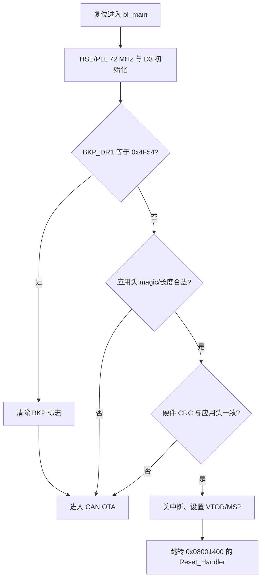
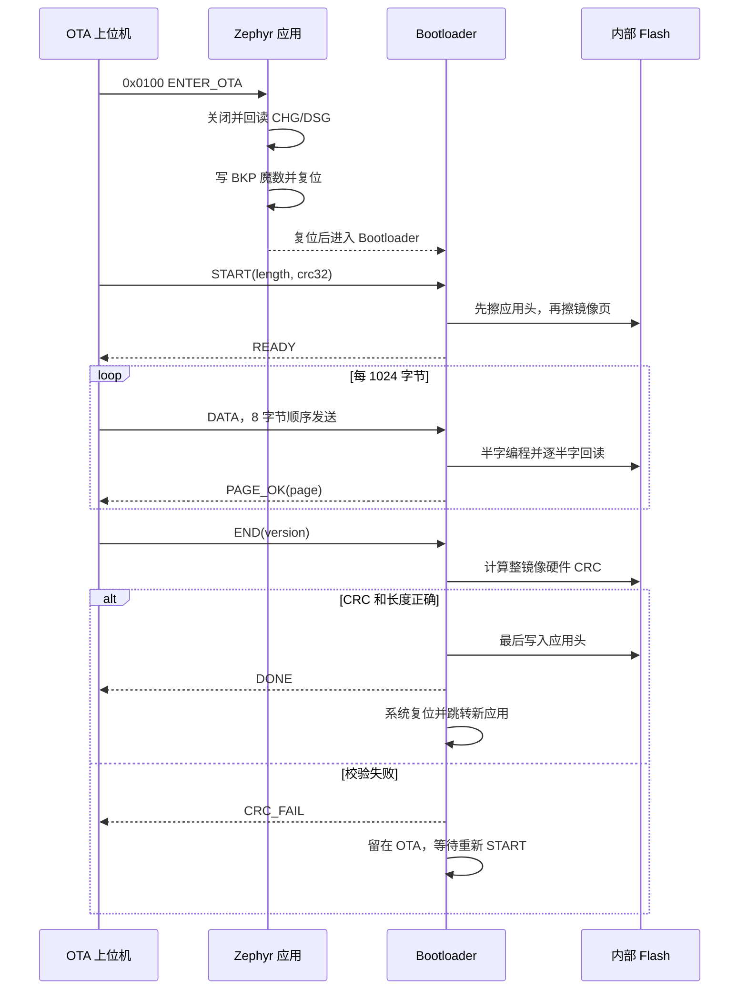

# Flex LoVo BMS CAN Bootloader

本目录是 STM32F103C8T6 的裸机 CAN Bootloader，不依赖 Zephyr。它负责在复位时
校验应用镜像、响应应用发起的 OTA 请求、通过 CAN 接收新镜像并在校验成功后提交。

当前方案是单槽升级：没有备份镜像和自动回滚。升级开始时先擦除应用头，使旧镜像
立即失效；升级中断或 CRC 失败后，设备会停留在 Bootloader，等待重新发送，不会跳转
到不完整应用。

## 目录说明

| 文件 | 作用 |
|---|---|
| [`bl.h`](bl.h) | Flash 布局、应用头、OTA CAN ID 和公共接口 |
| [`startup.c`](startup.c) | 向量表、复位入口和最小启动代码 |
| [`bl_main.c`](bl_main.c) | 时钟、应用校验、OTA 判定和应用跳转 |
| [`bl_ota.c`](bl_ota.c) | START/DATA/END 状态机、分页写入和提交 |
| [`bl_can.c`](bl_can.c) | STM32F103 bxCAN 500 kbit/s 寄存器驱动 |
| [`bl_flash.c`](bl_flash.c) | 内部 Flash 解锁、擦页、半字编程和回读 |
| [`stm32f103c8.ld`](stm32f103c8.ld) | Bootloader 链接脚本 |
| [`tools/header_gen.py`](tools/header_gen.py) | 生成首次烧录使用的应用头 |
| [`tools/ota_can.py`](tools/ota_can.py) | Python CAN OTA 发送端 |

## 运行环境与构建

需要 GNU Make 和 `arm-none-eabi-gcc`。当前已验证 xPack GNU Arm Embedded GCC
15.2.1-1.1。

```powershell
Set-Location .\bootloader
make GNUARMEMB_TOOLCHAIN_PATH=C:/Tools/xpack-arm-none-eabi-gcc-15.2.1-1.1
```

Windows 使用 Qt/MinGW 工具链时可改用：

```powershell
mingw32-make GNUARMEMB_TOOLCHAIN_PATH=C:/Tools/xpack-arm-none-eabi-gcc-15.2.1-1.1
```

也可把工具链放到仓库默认位置：
`Tools/arm-gcc/xpack-arm-none-eabi-gcc-15.2.1-1.1/`。构建产物包括：

- `bootloader.elf`：调试符号；
- `bootloader.bin`：原始镜像；
- `bootloader.hex`：首次 SWD 烧录；
- `bootloader.map`：链接和尺寸分析。

清理构建产物：

```powershell
make clean
```

## Flash 布局

STM32F103C8T6 按 64 KiB Flash、1 KiB 页组织：

```text
0x08000000 ┌──────────────────────────────┐
           │ Bootloader，4 KiB            │
0x08001000 ├──────────────────────────────┤
           │ 应用头，1 KiB 页              │
           │ 实际头结构占 16 字节          │
0x08001400 ├──────────────────────────────┤
           │ Zephyr 应用镜像，最大约 59 KiB │
0x08010000 └──────────────────────────────┘
```

地址定义集中在 [`bl.h`](bl.h)。固件
[`hw.conf`](../firmware/hw.conf) 的 `CONFIG_FLASH_LOAD_OFFSET=0x1400` 必须与
`APP_BASE_ADDR=0x08001400` 保持一致。

### 应用头格式

应用头由四个 STM32 小端 `uint32_t` 组成：

| 偏移 | 字段 | 含义 |
|---:|---|---|
| `0x00` | `magic` | `0x4F544201`，即应用提交标记 |
| `0x04` | `version` | 上位机指定的应用版本号 |
| `0x08` | `length` | 4 字节对齐后的镜像长度 |
| `0x0C` | `crc32` | STM32 硬件 CRC32 结果 |

应用头最后写入，相当于提交动作。只要 magic、长度或 CRC 任一不合法，Bootloader
就不会跳转应用。

## 启动流程



应用发起 OTA 时使用备份寄存器，而不是普通 RAM 标志；软件复位后该标志仍保留，
Bootloader 读出后立即清除，避免下一次普通复位再次误入 OTA。

## 首次 SWD 烧录

首次装机需要准备三段内容：Bootloader、真机应用和应用头。

### 1. 构建镜像

```powershell
.\firmware\build.ps1 -Hardware
Set-Location .\bootloader
make GNUARMEMB_TOOLCHAIN_PATH=C:/Tools/xpack-arm-none-eabi-gcc-15.2.1-1.1
Set-Location ..
```

### 2. 生成应用头

```powershell
python .\bootloader\tools\header_gen.py `
    .\firmware\build_hw\zephyr\zephyr.bin 1 .\bootloader\app_header.bin
```

脚本会把镜像尾部补 `0xFF` 到 4 字节对齐，输出长度和 CRC。应用头仅写 16 字节，
其余应用头页保持擦除态。

### 3. 使用 STM32CubeProgrammer 写入

连接 ST-Link 和目标板，先确认目标芯片、供电和 SWD 连接无误：

```powershell
STM32_Programmer_CLI.exe -c port=SWD mode=UR -halt `
    -w32 0xE0042004 0x00000307 `
    -w .\bootloader\bootloader.hex `
    -w .\firmware\build_hw\zephyr\zephyr.hex `
    -w .\bootloader\app_header.bin 0x08001000 `
    -v -rst
```

`0xE0042004` 是 DBGMCU 控制寄存器；该写入用于调试连接期间冻结 IWDG，防止已启动
看门狗干扰烧录。不同 STM32CubeProgrammer 版本若不接受一条命令中的多个 `-w`，
可保持连接并按相同顺序分三次写入，最后统一校验和复位。

复位后的最低检查：

1. Bootloader 没有持续快闪 D3；
2. USART1 输出 `BMS UART diag ready`；
3. 发送 `S` 能得到 SNAP；
4. CAN 总线上出现 `0x0001..0x0007` 扩展帧。

## 从应用进入 OTA

应用运行时，上位机先向扩展帧 ID `0x0100` 发送：

```text
A5 02 00 00 00 00 00 00
```

应用的 [`FaultProtectionTask`](../firmware/src/tasks/fault_protection_task.c) 会：

1. 关闭 CHG 与 DSG；
2. 回读确认两个 FET 都已关闭；
3. 写入并回读 BKP OTA 魔数；
4. 冷复位进入 Bootloader。

如果 FET 无法确认关闭，应用拒绝复位，继续留在保护逻辑中。该步骤用于让电池包在
升级期间处于电气离线状态。

## OTA on CAN 协议

### 总线参数

| 项目 | 值 |
|---|---|
| CAN 控制器 | CAN1，PA11 RX / PA12 TX |
| 波特率 | 500 kbit/s |
| 帧格式 | 29 位扩展数据帧 |
| DATA 负载 | 每帧最多 8 字节，严格顺序 |
| 分页大小 | 1024 字节 |

### 帧定义

多字节协议字段使用大端；这与写入 Flash 的小端应用头结构是两个不同边界。

| CAN ID | 方向 | 名称 | DLC 与数据 |
|---:|---|---|---|
| `0x0700` | Host → BL | `START` | DLC 8：`length[4] + crc32[4]` |
| `0x0701` | Host → BL | `DATA` | DLC 1～8：顺序镜像字节 |
| `0x0702` | Host → BL | `END` | DLC 4～8：`version[4]`，其余忽略 |
| `0x0708` | BL → Host | `STATUS` | DLC 3：`code[1] + page[2]` |

状态码：

| code | 名称 | 含义 |
|---:|---|---|
| 0 | `READY` | START 合法、应用头和目标镜像区已擦除 |
| 1 | `PAGE_OK` | 一页或最终不足一页的数据写入并回读成功 |
| 2 | `PAGE_ERR` | Flash 页写入或回读失败 |
| 3 | `DONE` | 全镜像 CRC 正确、应用头提交成功，即将复位 |
| 4 | `CRC_FAIL` | 长度或全镜像 CRC 不匹配 |
| 5 | `ERR` | START 参数或擦除过程错误 |

### 时序



`DATA` 帧本身没有偏移、序号或逐帧重传字段，因此发送端必须保持严格顺序，
每 1 KiB 等待 `PAGE_OK` 后再继续。若适配器或驱动发生丢帧，最终长度/CRC 会拒绝
提交；重新发送 `START` 可从头恢复。

### CRC 口径

三方必须完全一致：Bootloader 的 STM32 CRC 外设、`header_gen.py` 和 `ota_can.py`。

- 初值 `0xFFFFFFFF`；
- 多项式 `0x04C11DB7`；
- 按小端 32 位字喂入；
- 输入、输出均不反转；
- 无末尾异或；
- 镜像尾部以 `0xFF` 补到 4 字节对齐。

## 使用 Python OTA 工具

安装依赖：

```powershell
python -m pip install -r .\bootloader\tools\requirements.txt
```

Linux SocketCAN 示例：

```bash
python bootloader/tools/ota_can.py firmware/build_hw/zephyr/zephyr.bin \
    --version 2 --enter-ota --interface socketcan --channel can0
```

Windows PCAN 示例：

```powershell
python .\bootloader\tools\ota_can.py `
    .\firmware\build_hw\zephyr\zephyr.bin `
    --version 2 --enter-ota --interface pcan --channel PCAN_USBBUS1
```

`python-can` 的 `--interface` 和 `--channel` 取值由适配器驱动决定。某些硬件需要先在
厂商工具中配置 500 kbit/s，或不能由 `python-can` 重复设置 bitrate。

## 升级期间行为

- D3 以 10 Hz 快闪，表示设备正在 Bootloader/OTA 状态；
- Bootloader 无条件喂 IWDG，因为应用启动过 IWDG 后软件复位不会停止它；
- 收到合法 START 后先擦应用头，再擦所需镜像页；
- 每次 Flash 写入都有回读校验；
- 只有全镜像 CRC 成功后才写应用头并复位；
- 任意失败都保持应用头无效并留在 Bootloader，可重新发 START。

## 故障恢复

| 现象 | 处理 |
|---|---|
| 上位机收不到 `READY` | 检查是否已进入 Bootloader、500 kbit/s、扩展帧和终端电阻 |
| 返回 `ERR` | 检查镜像长度是否非零、4 字节对齐且不超过应用区 |
| 返回 `PAGE_ERR` | 重新上电后从 START 重传；持续失败时检查 Flash 写保护和供电 |
| 返回 `CRC_FAIL` | 确认发送的是 `zephyr.bin`、CRC 口径和 DATA 顺序，重新 START |
| 升级中断后无法进应用 | 属于预期安全状态，保持 CAN 连接并完整重传 |
| 设备持续快闪但 CAN 无响应 | 用 SWD 重新烧录 Bootloader，并检查 CAN 收发器/引脚 |

Bootloader 自身只能通过 SWD 恢复；OTA 不会擦除前 4 KiB Bootloader 区域。

## 代码阅读顺序

1. [`bl.h`](bl.h)：先记住 Flash 布局、应用头和 CAN ID。
2. [`bl_main.c`](bl_main.c)：理解复位后的决策树和应用跳转。
3. [`bl_ota.c`](bl_ota.c)：沿 START → DATA → END 阅读状态机。
4. [`bl_flash.c`](bl_flash.c)：确认擦写粒度、对齐和回读策略。
5. [`bl_can.c`](bl_can.c)：确认 bxCAN 时钟、位时序、过滤器和邮箱。
6. [`tools/header_gen.py`](tools/header_gen.py) 与
   [`tools/ota_can.py`](tools/ota_can.py)：核对主机侧 CRC 和时序。

## 安全边界与后续工作

- 当前没有固件签名、加密、防降级或设备身份认证；任何能访问 CAN 的节点都可能发起
  OTA。量产前必须增加真实性与授权校验。
- 当前为单槽，升级开始后旧应用不可回退；可靠性要求更高时应改为 A/B 槽或增加外部
  存储暂存与原子切换。
- DATA 没有序号和单帧重传；复杂总线环境建议增加块序号、窗口、超时和重试。
- 需要在欠压、掉电、bus-off、写保护和连续复位条件下做真机故障注入。
- Bootloader 使用寄存器级忙等，任何时钟或外设异常都可能停住；量产版本应增加明确
  超时、错误状态和受控复位策略。
