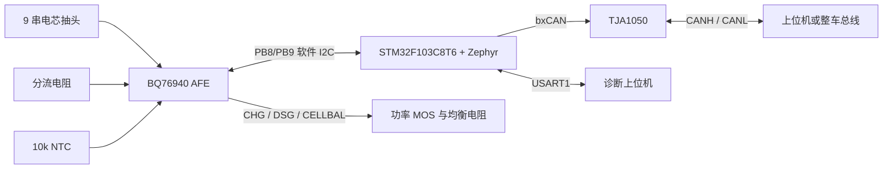
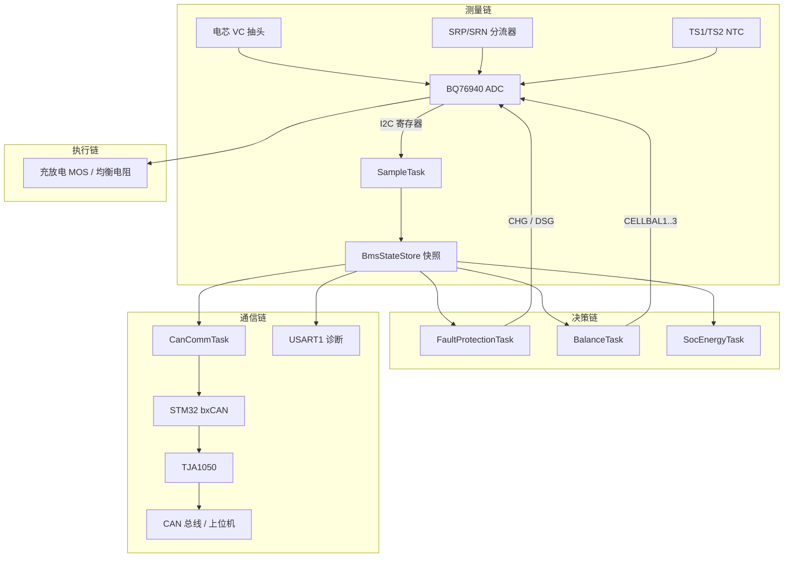
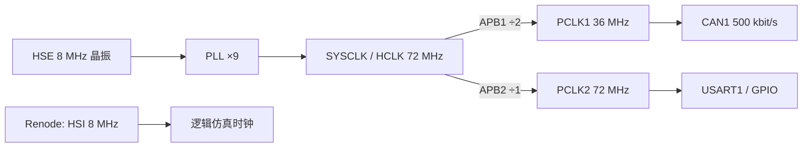
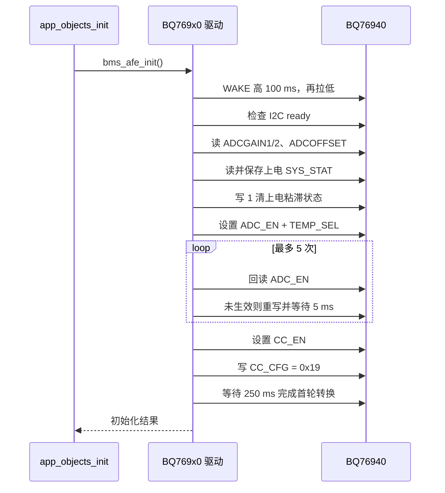
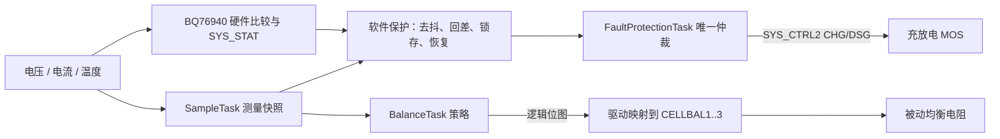
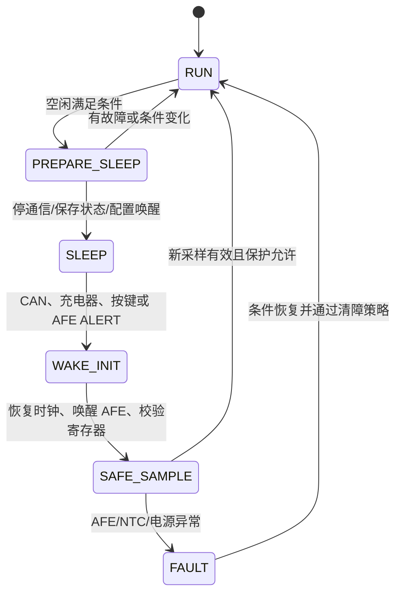
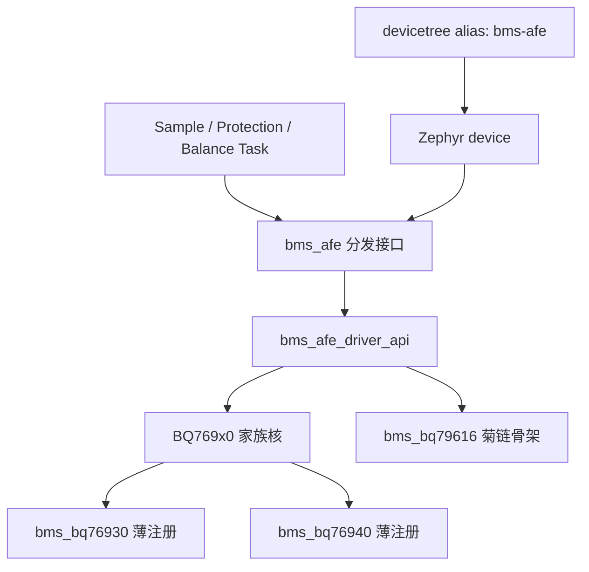

# 主控芯片选型与核心芯片使用：40 道递进面试题

本文以资深嵌入式工程师面试校招生的视角组织问题。重点不是背器件参数，而是考察
候选人能否从需求、原理图、数据手册、驱动代码、资源占用和真机现象形成完整证据链。

题目分为五个子话题，每组都从基本概念逐渐走向工程判断。问题区只列题目和答案跳转，
全部参考答案集中放在 Q40 之后，便于先独立作答再核对。

## 项目口径

- 当前实操主链路：`STM32F103C8T6 + BQ76940 + 10k NTC + CAN 收发器 +
  分立功率 MOS`。
- 当前软件平台：Zephyr RTOS；不是早期研究材料里设想的 FreeRTOS 工程。
- BQ34Z100-G1、BQ76200 是理论扩展器件，当前板卡没有完成接入。
- BQ79616-Q1 在仓库中只有接口骨架，菊链协议尚未实现。
- 2026-07-23 真机构建实测：应用 Flash 装载 `40068 B / 60416 B`，约
  `66.3%`；运行 RAM `12068 B / 20480 B`，约 `58.9%`。

核心项目入口：

- [板级事实](../../docs/board-facts/bms_board_facts.md)
- [硬件设备树](../../firmware/app.overlay)
- [真机时钟与 DMA](../../firmware/hw.overlay)
- [AFE 接口](../../firmware/drivers/afe/bms_afe.h)
- [BQ769x0 家族驱动](../../firmware/drivers/afe/bq769x0_core.c)
- [任务与资源配置](../../firmware/src/config/appconfig.h)

---

## 问题区

### 子话题一：系统认知与芯片职责

<a id="q1"></a>
#### Q1【初级】请快速说出当前 BMS 板卡的主控、AFE 和主要外围器件，并说明哪些器件真正接入了当前工程。

[参考答案 A1](#a1)

<a id="q2"></a>
#### Q2【初级】STM32F103C8T6 和 BQ76940 各自负责什么？为什么不能只用其中一颗完成整个 BMS？

[参考答案 A2](#a2)

<a id="q3"></a>
#### Q3【初级】AFE、电量计 Fuel Gauge 和 MOS 驱动器有什么区别？BQ76940、BQ34Z100-G1、BQ76200 分别属于哪一类？

[参考答案 A3](#a3)

<a id="q4"></a>
#### Q4【初级】STM32F103 已经带 bxCAN，为什么板上还需要 TJA1050 一类 CAN 收发器？

[参考答案 A4](#a4)

<a id="q5"></a>
#### Q5【中级】为什么不直接用 STM32 的片内 ADC 测量 9 节串联电芯，而要增加 BQ76940？

[参考答案 A5](#a5)

<a id="q6"></a>
#### Q6【中级】面试时如何准确区分“当前已实现”“仓库有骨架”和“只做过理论研究”，避免把项目能力说大？

[参考答案 A6](#a6)

<a id="q7"></a>
#### Q7【中级】请从电芯开始，画出采样、保护、功率执行和通信上报的芯片级数据流。

[参考答案 A7](#a7)

<a id="q8"></a>
#### Q8【高级】如果原理图、旧代码、BoardFacts 和研究文档对 MCU 型号或引脚描述互相矛盾，你如何判定哪一份是真的？

[参考答案 A8](#a8)

### 子话题二：主控 MCU 选型、资源与时钟

<a id="q9"></a>
#### Q9【初级】为低压 BMS 选择 MCU 时需要看哪些指标？为什么不能只比较主频和 Flash？

[参考答案 A9](#a9)

<a id="q10"></a>
#### Q10【初级】STM32F103C8T6 的哪些资源与本项目直接匹配？它有哪些明显短板？

[参考答案 A10](#a10)

<a id="q11"></a>
#### Q11【中级】你如何证明 72 MHz 对本项目“够用”，而不是凭感觉说够用？

[参考答案 A11](#a11)

<a id="q12"></a>
#### Q12【中级】如何根据当前链接结果判断 64 KiB Flash 和 20 KiB SRAM 是否还有安全余量？

[参考答案 A12](#a12)

<a id="q13"></a>
#### Q13【中级】Cortex-M3 没有 FPU，会不会影响电压、电流、温度和 SOC 算法？项目如何避免软浮点代价？

[参考答案 A13](#a13)

<a id="q14"></a>
#### Q14【中级】真机为什么使用 HSE 8 MHz 经 PLL 倍频到 72 MHz，而 Renode 默认使用 HSI 8 MHz？

[参考答案 A14](#a14)

<a id="q15"></a>
#### Q15【高级】请结合 PA11/PA12、PB8/PB9 和 PA15，说明 MCU 选型时为什么必须检查引脚复用，而不是只数外设数量。

[参考答案 A15](#a15)

<a id="q16"></a>
#### Q16【高级】什么情况下应从 STM32F103C8T6 升级到 F103CB、STM32G0/G4 或车规 MCU？请给出可执行的触发条件。

[参考答案 A16](#a16)

### 子话题三：BQ76940 选型与驱动使用

<a id="q17"></a>
#### Q17【初级】本项目为什么选择 BQ76940，而不是 BQ76930 或普通保护 IC？

[参考答案 A17](#a17)

<a id="q18"></a>
#### Q18【初级】BQ76940 有 15 个 VC 通道，项目为什么只按 9 个逻辑电芯运行，而且映射不是 VC1 到 VC9 连续排列？

[参考答案 A18](#a18)

<a id="q19"></a>
#### Q19【中级】BQ76940 从上电到可以稳定采样，驱动初始化需要完成哪些步骤？顺序错了会出现什么现象？

[参考答案 A19](#a19)

<a id="q20"></a>
#### Q20【中级】BQ76940 的 7 位地址 `0x08`、写地址字节 `0x10`、读地址字节 `0x11` 和 CRC 是什么关系？

[参考答案 A20](#a20)

<a id="q21"></a>
#### Q21【中级】电芯 ADC 原始值如何转换成 mV？为什么要在启动时读取 ADCGAIN 和 ADCOFFSET？

[参考答案 A21](#a21)

<a id="q22"></a>
#### Q22【高级】把 18 次单字节读取优化成 burst 后，为什么第一次得到了一组“看起来有数、实际上全错”的电压？

[参考答案 A22](#a22)

<a id="q23"></a>
#### Q23【高级】为什么真机充电时 BQ 的 CC 原始值为正，而项目上层约定充电为负？`CC_READY` 又为什么不能当故障？

[参考答案 A23](#a23)

<a id="q24"></a>
#### Q24【高级】BQ76940 的硬件保护、软件保护、CHG/DSG 控制和被动均衡应该如何分层，谁拥有最终功率控制权？

[参考答案 A24](#a24)

### 子话题四：温度、功率器件与配套芯片

<a id="q25"></a>
#### Q25【初级】10k NTC 如何通过 BQ76940 的 TS 通道得到温度？为什么项目使用整数查表而不是实时计算对数公式？

[参考答案 A25](#a25)

<a id="q26"></a>
#### Q26【初级】当前板卡的 CHG/DSG 是如何控制功率 MOS 的？读取 `SYS_CTRL2` 能否证明 MOS 真的导通或关断？

[参考答案 A26](#a26)

<a id="q27"></a>
#### Q27【中级】BQ76200 解决了什么问题？高边 N-MOS 驱动相比当前方案有什么收益和新增风险？

[参考答案 A27](#a27)

<a id="q28"></a>
#### Q28【中级】如果加入 BQ34Z100-G1，它与 BQ76940 和 MCU 软件 SOC 如何分工？接上芯片是否就自动得到准确 SOC？

[参考答案 A28](#a28)

<a id="q29"></a>
#### Q29【中级】CAN 收发器和终端电阻在 BMS 中分别解决什么问题？UART 正常但 CAN 无 ACK 时应如何排查？

[参考答案 A29](#a29)

<a id="q30"></a>
#### Q30【中级】从电池包到 MCU 的电源链路需要核对哪些参数？为什么“MCU 能启动”不能证明供电设计可靠？

[参考答案 A30](#a30)

<a id="q31"></a>
#### Q31【高级】如果要加入低功耗、运输模式和 CAN/充电器唤醒，MCU、AFE、收发器和 MOS 状态应该如何协同？

[参考答案 A31](#a31)

<a id="q32"></a>
#### Q32【高级】面对“电压和温度全为 0，但电流仍正常”或“无故关 FET”这类现象，如何利用芯片内部功能分区快速定位？

[参考答案 A32](#a32)

### 子话题五：驱动架构、验证与平台演进

<a id="q33"></a>
#### Q33【初级】为什么引脚、地址和电芯映射放在 devicetree，而保护阈值、任务周期放在 `appconfig.h`？

[参考答案 A33](#a33)

<a id="q34"></a>
#### Q34【中级】项目如何抽象 AFE 驱动，使 BQ76930、BQ76940 和 BQ79616 可以面向同一上层接口？

[参考答案 A34](#a34)

<a id="q35"></a>
#### Q35【中级】多个 Zephyr 任务都可能访问 BQ76940 时，如何保证 I2C 多寄存器操作不会互相打断？为什么不能在 ISR 中直接读 AFE？

[参考答案 A35](#a35)

<a id="q36"></a>
#### Q36【中级】位翻转 I2C 和轮询 UART 曾挤占 CPU，项目如何优化实时性？如何证明优化没有破坏数据正确性？

[参考答案 A36](#a36)

<a id="q37"></a>
#### Q37【高级】从单点失效角度审查当前保护链路：MCU 卡死、AFE 失联、NTC 断线、MOS 焊死时分别由谁兜底？

[参考答案 A37](#a37)

<a id="q38"></a>
#### Q38【高级】把当前 9 串改成 15 串，或者换成 BQ76930 做 10 串，仅修改 devicetree 是否足够？

[参考答案 A38](#a38)

<a id="q39"></a>
#### Q39【高级】如果升级到高压或车规 BMS，为什么不能只把 BQ76940 换成 BQ79616-Q1？系统架构还要改变什么？

[参考答案 A39](#a39)

<a id="q40"></a>
#### Q40【高级】现在让你从零设计一款 48 V BMS，你会如何重新选择 MCU、AFE、电量计和 MOS 驱动，并证明不是过度设计？

[参考答案 A40](#a40)

---

## 参考答案区

### 子话题一答案：系统认知与芯片职责

<a id="a1"></a>
### A1

当前板卡的主控是 `STM32F103C8T6`，LQFP48 封装，负责运行 Zephyr、调度任务、
执行软件保护与算法、组织 CAN/UART 数据。AFE 是 `BQ76940`，负责多节电芯电压、
分流电流、TS 温度通道、芯片级保护状态、被动均衡以及 CHG/DSG 控制入口。

与主链路直接相关的外围还有：

| 器件或电路 | 当前状态 | 作用 |
|---|---|---|
| 10k NTC | 已随板卡接入，当前保护使用 TS1 | 电芯或板端温度检测 |
| TJA1050 CAN 收发器 | 已在原理图链路中 | 把 MCU 的 CAN 逻辑电平转换为 CANH/CANL 差分信号 |
| 分立功率 MOS | 已在当前板卡链路中 | 执行充电、放电通断 |
| MP9486A、AMS1117 等电源器件 | 板级供电链路 | 从电池包侧产生控制系统所需电源轨 |
| BQ34Z100-G1 | 未接入，只做理论研究 | 专用 Fuel Gauge，估算 SOC/SOH、容量学习 |
| BQ76200 | 未接入，只做理论研究 | 高边 N-MOS 充放电驱动 |
| BQ79616-Q1 | 仅有未完成驱动骨架 | 面向车规多芯片菊链的 16S 监测器 |

判断“是否接入”不能只看文档里出现了器件名，要看原理图、设备树、构建源文件和实际
驱动调用链。当前硬件事实集中在
[app.overlay](../../firmware/app.overlay) 和
[BoardFacts](../../docs/board-facts/bms_board_facts.md)，当前编入工程的驱动列表见
[CMakeLists.txt](../../firmware/CMakeLists.txt)。

[返回 Q1](#q1)

<a id="a2"></a>
### A2

STM32 和 BQ76940 的关系是“数字控制器 + 电池模拟前端”，两者职责不同。



BQ76940靠近模拟世界。它承受多串电芯输入，完成 ADC 转换、电流比较、TS 采样和
OV/UV/OCD/SCD 等硬件状态检测。STM32 不直接承受这些高共模输入，而是通过 I2C 读取
已经数字化的数据，并完成去抖、回差、故障锁存、SOC、均衡策略、通信和诊断。

只用 STM32，会缺少适合多串电芯的高共模采样、独立快速比较器和专用保护链路；只用
BQ76940，则缺少完整业务状态机、协议栈、任务调度和可扩展算法。项目中的组合根在
[app_objects.c](../../firmware/src/core/app_objects.c)，采样入口在
[sample_task.c](../../firmware/src/tasks/sample_task.c)。

[返回 Q2](#q2)

<a id="a3"></a>
### A3

三类器件的区别可以用“看得见、算得准、切得动”来记，但面试时要落回工程定义。

| 类别 | 主要输入 | 主要输出 | 本项目器件 | 能否互相替代 |
|---|---|---|---|---|
| AFE | 单体电压、分流电压、NTC、电芯故障 | 原始测量值、硬件状态、均衡/FET 控制 | BQ76940 | 不能被 Fuel Gauge 替代 |
| Fuel Gauge | 包电压、电流、温度、化学模型和历史状态 | SOC、SOH、剩余容量、Qmax、循环信息 | BQ34Z100-G1（未接入） | 不能替代多串单体保护 |
| MOS 驱动 | CHG/DSG/PCHG 使能 | 足够幅值和时序的栅极驱动 | 当前分立链路；BQ76200 为扩展 | 不负责判断何时保护 |

BQ76940 提供安全数据和执行入口，但它不是完整的 SOC 算法系统。BQ34Z100-G1 擅长
容量估算，但不知道每一节电芯是否过压，也不能替代 BQ76940。BQ76200 可以把保护命令
可靠地变成高边 N-MOS 栅极电压，但它不决定保护阈值。

一个成熟回答还要说明项目边界：当前软件 SOC 由
[bms_energy_estimator.c](../../firmware/src/algo/bms_energy_estimator.c) 完成，
没有把 BQ34Z100-G1 的结果伪装成实测；当前 FET 操作仍通过
[BQ769x0 驱动](../../firmware/drivers/afe/bq769x0_core.c) 的 `SYS_CTRL2` 完成。

[返回 Q3](#q3)

<a id="a4"></a>
### A4

bxCAN 是协议控制器，TJA1050 是物理层收发器。bxCAN 负责位时序、仲裁、帧格式、CRC、
错误计数和邮箱；它输出的是 MCU 电压域里的 `CAN_TX`，接收的也是逻辑电平 `CAN_RX`。
CANH/CANL 则是差分总线，需要收发器提供驱动能力、共模范围和总线电气接口。

因此 MCU 的 PA12 连接收发器 TXD，PA11 接收 RXD，收发器另一侧才连接 CANH/CANL。
两端终端电阻、线束阻抗、支线长度、ESD/浪涌和地偏移都属于物理层问题，不是 bxCAN
配置能替代的。项目在
[app.overlay](../../firmware/app.overlay) 中配置 `CAN1 = 500 kbit/s`，
但这只能证明控制器参数进入构建，不能证明总线上一定有 ACK。

排查时应把两层分开：

1. 看 MCU TX 引脚是否有正确位流；
2. 看 CANH/CANL 是否形成合格差分波形；
3. 测量断电总线两线间是否约为两个 120 Ω 并联后的 60 Ω；
4. 检查对端是否上电、同波特率且真正发送 ACK；
5. 再检查错误计数、bus-off 和过滤器。

[返回 Q4](#q4)

<a id="a5"></a>
### A5

串联电芯抽头不是九路相对于 MCU 地的 0～3.3 V 信号。越靠近包正端，共模电压越高；
直接接 MCU ADC 会超过绝对最大额定值。即使加九组分压，还会遇到分压误差、输入泄漏、
共模范围、地线压降、采样不同步、开线诊断和保护响应不足等问题。

BQ76940 的价值不只是“多几个 ADC 通道”，而是把这些功能放在电池侧统一实现：

- 适配 9～15 串电芯输入与分组供电；
- 对单体电压做专用 ADC 采样与增益/偏移校准；
- 通过 SRP/SRN 测电流并提供 OCD/SCD 快速检测；
- 通过 TS 通道测温；
- 提供 CELLBAL、CHG、DSG 和粘滞故障状态；
- 在 MCU 软件失效或任务延迟时，仍保留独立硬件保护层。

MCU 片内 ADC 仍可用于辅助电源、板温或 PACK 检测，但不能在没有隔离和专用前端的情况
下替代多串 AFE。BQ76940 的寄存器和板级采样口整理在
[bq76940_config.json](../../docs/board-facts/bq76940_config.json)。

[返回 Q5](#q5)

<a id="a6"></a>
### A6

可信的项目表达应按证据把能力分成三档：

| 表达级别 | 判定证据 | 当前例子 | 面试中应如何说 |
|---|---|---|---|
| 已实现并验证 | 有硬件/代码调用链/构建/测试或实测日志 | STM32F103C8T6、BQ76940、NTC、Zephyr、CAN/UART、Renode | “已实现，验证边界是……” |
| 有接口或骨架 | 文件能编译，但核心传输返回 `-ENOSYS` 或没有硬件节点 | BQ79616-Q1 驱动骨架 | “完成了接口占位，菊链协议未实现” |
| 理论研究 | 有选型和原理分析，没有原理图接入、驱动和实测 | BQ34Z100-G1、BQ76200 | “分析过方案与集成边界，未在本板调试” |

例如 [bms_bq79616.c](../../firmware/drivers/afe/bms_bq79616.c) 明确存在
`TODO(bq79616)`，核心函数返回 `-ENOSYS`。把它说成“已经支持车规菊链”会被面试官
沿着自动编址、CRC16、隔离链路和故障注入连续追问，很快暴露。

同理，Renode 能证明寄存器流程、任务协作和协议解析，不能证明模拟精度、真实 CAN
物理层、EMC 或 MOS 关断能力。优秀回答不是把项目说得最大，而是把“做到了什么、
如何证明、还缺什么”说得最清楚。

[返回 Q6](#q6)

<a id="a7"></a>
### A7

从电芯到主回路和上位机，可以分成测量链、决策链、执行链和通信链：



这里最关键的设计点是：采样任务发布一致快照，其他任务不重复读取整套 AFE 数据；
保护任务是 CHG/DSG 的唯一软件仲裁者；CAN/UART 只读状态，不在发送路径里临时访问
硬件。完整任务时序可对照 [固件 README](../../firmware/README.md#一次采样周期的任务流程)。

[返回 Q7](#q7)

<a id="a8"></a>
### A8

硬件事实发生冲突时，应建立证据优先级，而不是选择最方便的一份：

1. 实物丝印、芯片顶标、原理图和 BOM；
2. 示波器、逻辑分析仪、寄存器 ID、链接地址等可重复测量；
3. 最终生效的设备树、链接脚本和外设寄存器配置；
4. 由一手资料整理出的 BoardFacts；
5. 厂家示例代码、旧注释和研究文档。

本项目有两个典型案例。第一，早期资料曾把 MCU 写成 `STM32F103C6`，但原理图 U1 明确
是 `STM32F103C8T6`，当前链接也按 64 KiB Flash、20 KiB SRAM 构建，因此以 C8 为准并
回填 [pinmap.json](../../docs/board-facts/pinmap.json)。第二，厂家旧代码曾把 PA12
初始化成普通 GPIO，但随后 CAN 初始化把它重新配置成 `CAN1_TX`；原理图和最终复用状态
都支持 PA12 属于 CAN。

推荐的纠偏流程是：

```text
发现冲突
  -> 列出每个说法及来源
  -> 找一手硬件证据
  -> 用运行时测量或最终构建配置复核
  -> 修正 BoardFacts
  -> 再让设备树、测试平台和文档引用同一份事实
```

面试官真正关注的是候选人是否有“证据分级”和“闭环修订”意识，而不是能否背出某个
引脚。项目的 PA12 核对过程已记录在
[BoardFacts 的 PA12 判定](../../docs/board-facts/bms_board_facts.md#pa12-判定)。

[返回 Q8](#q8)

### 子话题二答案：主控 MCU 选型、资源与时钟

<a id="a9"></a>
### A9

低压 BMS 的 MCU 选型应从系统约束开始，而不是先打开芯片选型表。至少需要回答以下问题：

| 维度 | 应核对的内容 | 本项目落点 |
|---|---|---|
| 安全与实时性 | 最快故障由谁响应，软件截止期是多少，是否需要独立看门狗 | AFE 承担快速保护，MCU 采样周期 100 ms |
| 存储 | 应用、Bootloader、升级区、参数、日志、任务栈需要多少空间 | 64 KiB Flash、20 KiB SRAM，单槽 OTA |
| 通信 | CAN 2.0/FDCAN、UART、SPI、I2C 的数量、速率与并发 | bxCAN、软件 I2C、USART1 |
| 引脚和电气 | 引脚复用、5 V 容限、外部晶振、调试口、封装 | LQFP48，PA11/12 CAN，PA15 与 JTAG 复用 |
| 算法 | 是否需要 FPU、DSP、矩阵运算、加密或硬件 CRC | 当前以整数/定点为主 |
| 低功耗 | 工作、待机、运输模式电流和唤醒源 | 当前尚未形成完整低功耗闭环 |
| 质量属性 | 温度等级、AEC-Q100、功能安全资料、ECC、MPU | F103C8T6 是工业器件，不是车规安全 MCU |
| 工程生态 | RTOS、编译器、调试器、驱动成熟度、长期供货 | Zephyr、GCC、ST-Link 生态成熟 |

主频只回答“每秒最多执行多少工作”的一部分。BMS 还可能被 Flash 布局、任务栈、
CAN 时钟精度、低功耗静态电流、器件温度等级或安全认证卡住。一个 200 MHz MCU 若没有
合适 CAN、Flash 不支持升级布局，或者没有目标质量等级，也不是正确选型。

工程上应先形成“必须满足、应满足、可选”的需求表，再为每项给权重和验证方式。这样
选出的芯片可以追溯到需求，而不是追溯到个人熟悉度。

[返回 Q9](#q9)

<a id="a10"></a>
### A10

STM32F103C8T6 是 72 MHz Cortex-M3，具有 64 KiB Flash、20 KiB SRAM、bxCAN、
I2C、SPI、USART、定时器、DMA、GPIO、EXTI 和独立看门狗。对当前项目而言，匹配点是：

- 一路 bxCAN 对接 500 kbit/s 低压 BMS 总线；
- USART1 提供 115200 诊断口，并可在真机上用 DMA 发送；
- GPIO 可实现 BQ76940 软件 I2C、唤醒和状态灯；
- Cortex-M3 的 NVIC、SysTick 和 Zephyr 支持足以承载当前任务；
- 片内 Flash 可放 4 KiB Bootloader、1 KiB 应用头和约 59 KiB 应用区；
- ST-Link/SWD、GCC 和现成板卡资料降低了 bring-up 成本。

它的短板同样明确：Flash/RAM 不宽裕，没有 FPU、FDCAN、硬件安全模块、ECC RAM、
车规质量等级和面向 ISO 26262 的完整安全资料。复杂诊断、双镜像 OTA、长日志、TLS、
高阶模型算法或量产车规安全目标都会快速突破边界。

截至本文核对时，ST 官方仍把
[STM32F103C8T6](https://www.st.com/en/microcontrollers-microprocessors/stm32f103c8.html)
列为 Active，但“仍可采购”不等于“所有新产品都应继续选它”。当前项目沿用它的核心理由是
已有板卡与需求匹配，而不是因为它在所有指标上最新。

[返回 Q10](#q10)

<a id="a11"></a>
### A11

证明“够用”需要做可调度性预算和实测，而不是把 72 MHz 与某个经验数字比较。第一步先
区分两条实时链路：

- 短路、严重过流等快速风险由 BQ76940 的比较器和 FET 链路优先响应；
- MCU 负责 100 ms 周期采样、软件二次保护、状态估算和通信。

对周期任务，可用下面的近似检查建立第一版预算：

```text
CPU 利用率 U ≈ Σ(Ci / Ti) + 中断开销 + 阻塞开销

Ci = 任务在最坏输入下的执行时间
Ti = 任务周期或最小到达间隔
```

本项目的真正大户不是保护比较，而是软件位翻转 I2C 和早期轮询 UART。真机调试曾测到：
逐字节采样约 69 ms；修正 burst 与 CRC 字节处理后约 58.5 ms，并消除了当时记录的采样
超期。这个数值不是所有板卡的通用规格，但它证明了“先测最坏路径，再谈主频余量”的方法。
相关实现见 [bq769x0_core.c](../../firmware/drivers/afe/bq769x0_core.c)。

进一步验证应包括：

1. 用绝对时间周期记录 `start/end/duration/deadline_miss`；
2. 在 CAN 满载、UART 输出、故障频发和 I2C 重试同时发生时取最大值；
3. 检查最低优先级 AuxiliaryTask 是否仍能运行并喂狗；
4. 记录任务栈高水位和 ISR 时间；
5. 留出故障重试、温度变化和未来功能的余量。

当前 [SampleTask](../../firmware/src/tasks/sample_task.c) 使用绝对时间睡眠，并在超期后跳过
已经错过的周期，避免相对延时不断漂移。只有这些数据都满足截止期，才能说 72 MHz 够用。

[返回 Q11](#q11)

<a id="a12"></a>
### A12

判断存储余量应使用当前工具链的最终 ELF/map，而不是源码文件大小。2026-07-23 对真机构建
执行 `arm-none-eabi-size` 得到：

```text
text    data    bss     dec
39336   732     11336   51404
```

计算口径如下：

```text
Flash 装载 = text + data = 39336 + 732 = 40068 B
运行 RAM   = data + bss  =   732 + 11336 = 12068 B
```

由于 Bootloader 占前 4 KiB、应用头占 1 KiB，应用从 `0x08001400` 开始，可用空间是
`65536 - 0x1400 = 60416 B`。因此当前应用 Flash 为 `40068 / 60416 = 66.3%`，
剩余 `20348 B`；RAM 为 `12068 / 20480 = 58.9%`，剩余 `8412 B`。布局常量可核对
[bl.h](../../bootloader/bl.h)、
[Bootloader 链接脚本](../../bootloader/stm32f103c8.ld) 和
[hw.conf](../../firmware/hw.conf)。

仅看总量仍不够。RAM 还要逐任务看峰值：当前
[appconfig.h](../../firmware/src/config/appconfig.h) 记录了插桩构建的栈高水位，并按
“峰值占用不超过约 60%”定尺。例如 AuxiliaryTask 曾使用 588 B，栈从 640 B 调整到
1024 B；否则 91% 峰值已经是高风险。

推荐把升级门槛写进工程约束，例如：

- 发布构建 Flash 长期不超过 80%；
- 静态 RAM 加最坏栈后仍保留至少 20%～25%；
- 每个任务最坏栈保留至少 30%～40%；
- 新功能合入时对比 map，而不是等链接溢出才处理。

`data` 会同时占 Flash 初值和运行 RAM，这也是不能简单把 `dec` 当成某一类存储占用的原因。

[返回 Q12](#q12)

<a id="a13"></a>
### A13

没有 FPU 不等于不能表达小数。BMS 的物理量很适合定点单位：

| 物理量 | 项目单位 | 推荐类型示例 |
|---|---|---|
| 单体/包电压 | mV | `uint16_t` / `uint32_t` |
| 电流 | mA，放电为正 | `int16_t` / `int32_t` |
| 温度 | 0.01 °C | `int16_t` |
| SOC/SOH | 0.1%，1000 表示 100.0% | `uint16_t` |
| 容量 | mAh 或内部 µAh | `int32_t` / `int64_t` |

电压保护只需要比较 `cell_mv >= 4200`，温度保护比较 `temperature_cdeg >= 5500`，
不需要浮点。NTC 也在 [bms_ntc.c](../../firmware/drivers/sensor/bms_ntc.c) 中使用
离线查表和整数线性插值，避免 `log()` 和软浮点库。

固定点实现必须处理中间值溢出和舍入。以库仑积分为例，不能每 100 ms 都先除成整数 mAh，
否则小电流增量会被反复截断。更稳妥的伪代码是保留余数：

```c
/* current_mA: 放电为正；acc_mA_ms 跨周期保存 */
acc_mA_ms += (int64_t)current_mA * dt_ms;
delta_uAh = acc_mA_ms / 3600;
acc_mA_ms %= 3600;
remain_uAh = clamp(remain_uAh - delta_uAh, 0, qmax_uAh);
```

当前 [bms_energy_estimator.c](../../firmware/src/algo/bms_energy_estimator.c) 已使用
`int64_t` 中间乘法，但其按周期直接换算整数 mAh 的实现仍可能丢失细小增量；这是后续算法
精化时应增加余数累加器的地方。面试时主动指出精度边界，比笼统说“定点一定更好”更可信。

当需求升级到高频 EKF/UKF、矩阵运算、在线参数辨识或复杂 SOH/SOP 模型时，M4F/M7 的 FPU
和 DSP 指令才会成为实质收益；当前瓶颈主要仍是采样链路和标定质量。

[返回 Q13](#q13)

<a id="a14"></a>
### A14

真机与仿真使用两套时钟，是因为验证目标不同。



真机使用外部 8 MHz 晶振的主要原因是 CAN 位时序需要稳定、准确的时钟；HSI 的精度和温漂
不适合作为生产 CAN 时钟依据。PLL ×9 得到 F103 标称 72 MHz，APB1 必须二分频到 36 MHz
以满足该总线频率上限，并为 CAN 500 kbit/s 提供可计算的时间量子组合。Flash 在 72 MHz
下也要匹配等待态，不能只改 PLL。

Renode 默认使用 HSI 8 MHz，是因为其 STM32 模型不完整模拟外部晶振和 PLL 起振握手。仿真
用于验证驱动流程、任务、协议和故障状态，不用于证明真实 CAN 时钟精度。公共配置在
[app.overlay](../../firmware/app.overlay)，真机覆盖项在
[hw.overlay](../../firmware/hw.overlay)；构建产物分到 `build/` 和 `build_hw/`，
避免把仿真时钟误烧入真机。

回答这个问题的重点不是“72 比 8 快”，而是理解时钟树会同时影响 CPU、APB 上限、CAN
位时序、Flash 等待态和仿真模型。

[返回 Q14](#q14)

<a id="a15"></a>
### A15

外设数量满足，不代表这些外设能在目标封装上同时使用。当前 LQFP48 的关键复用关系是：

| 信号 | 引脚 | 当前用途 | 容易踩的坑 |
|---|---|---|---|
| CAN1_RX / TX | PA11 / PA12 | 500 kbit/s CAN | PA12 在旧代码里有遗留 GPIO 别名 |
| BQ I2C SCL / SDA | PB8 / PB9 | GPIO 开漏位翻转 | 不能同时让硬件 I2C 驱动和 GPIO 抢占 |
| USART1 TX / RX | PA9 / PA10 | 115200 诊断 | DMA 通道只在真机构建启用 |
| 状态灯 D3 | PA15 | 低有效 GPIO | PA15 默认是 JTDI，需禁用 JTAG |
| SWDIO / SWCLK | PA13 / PA14 | 下载和调试 | 必须保留，不能为了 GPIO 全关调试口 |

项目通过 `swj-cfg = "jtag-disable"` 释放 PA15，同时保留 SWD；这和“关闭所有调试功能”
不是一回事。PA12 则以最终复用为准：启动早期旧代码的 GPIO 初始化会被后续 CAN 配置覆盖，
当前设备树直接把它归给 CAN1_TX。详细事实见
[pinmap.json](../../docs/board-facts/pinmap.json)。

选型评审时应做一张“封装引脚占用矩阵”，检查外设重映射、调试口、晶振、启动脚、DMA
通道和 5 V 容限。还要检查芯片内部共享资源；当前 overlay 明确关闭 USB 和未用串口/I2C/SPI，
既减少冲突，也避免无用驱动占用资源。

[返回 Q15](#q15)

<a id="a16"></a>
### A16

升级 MCU 应由明确触发条件驱动，而不是看到新型号就迁移。

| 候选方向 | 解决的问题 | 仍需注意 |
|---|---|---|
| STM32F103CB | 同系列 128 KiB Flash，迁移成本较低 | SRAM、无 FPU、老外设架构仍基本不变 |
| STM32G0B1 | 更大 Flash/RAM、双 FDCAN、较新低功耗与安全特性 | Cortex-M0+ 无 FPU，需要重做底层与时钟 |
| STM32G431/G474 | M4F、FDCAN、较强模拟与运算能力 | 对当前简单算法可能过剩，迁移量更大 |
| S32K、RH850、AURIX 等车规 MCU | 车规温度/质量、安全资料、汽车通信生态 | 成本、工具链和功能安全流程显著增加 |

可执行的触发条件包括：

- 发布构建 Flash 超过 80%，或单槽 OTA 已无法容纳必要功能；
- RAM 超过约 75%，任何关键任务栈余量低于 30%；
- 最坏负载下持续出现 deadline miss，优化 I/O 后仍无法满足；
- 需要 A/B 镜像、安全启动、固件签名、大日志或完整诊断栈；
- 需要 FDCAN、双 CAN、硬件密码模块、FPU/DSP 或更低静态功耗；
- 产品目标进入 AEC-Q100、ISO 26262 或更高温度等级；
- 供应生命周期、假货风险和量产可追溯性成为主要约束。

当前应用 Flash 约 66.3%、RAM 约 58.9%，还没有仅因容量必须换 MCU，但完整双分区 OTA
已经不适合这颗 64 KiB 器件。新工业 48 V 方案可以评估
[STM32G0B1](https://www.st.com/en/microcontrollers-microprocessors/stm32g0b1cc.html)；
复杂算法再考虑 M4F。车规项目则应先定义安全目标，再选 MCU 家族，不能把“换成车规料号”
当成功能安全设计本身。

[返回 Q16](#q16)

### 子话题三答案：BQ76940 选型与驱动使用

<a id="a17"></a>
### A17

BQ76940 是 BQ769x0 家族的 9～15 串 AFE，集成多节电芯 ADC、库仑计 ADC、TS 温度通道、
OV/UV/OCD/SCD 保护状态、被动均衡控制、CHG/DSG 输出和 I2C。它与当前发货板原理图、
厂家示例、9 串实物接线和 15 通道测试模型一致，因此沿用它能把工程重心放在驱动可靠性、
任务化和保护闭环，而不是先重做硬件。

BQ76930 支持较低串数，单从“9 串”看也可能满足，但当前板已经围绕 BQ76940 的封装、
分组供电和 VC 槽位布线。换成 BQ76930 不是改一个宏，需要重新核对原理图、输入滤波、
器件封装、TS 通道和软件映射。项目为同家族保留了薄驱动
[bms_bq76930.c](../../firmware/drivers/afe/bms_bq76930.c)，这证明软件复用方向，但不证明
现有硬件可以直接替换。

普通保护 IC 可以低成本完成固定阈值关断，却通常缺少完整单体数据、可编程策略、CAN 状态
上报、故障快照和可测试接口，无法满足本项目“可观测、可调试、可扩展”的目标。

TI 官方
[BQ76940 数据手册](https://www.ti.com/lit/ds/symlink/bq76940.pdf) 的 2026 年封装附录仍列出
Active Production 料号。但它是适合当前低压原型的工业 AFE，不应被描述成当前主流高压
车规菊链方案。

[返回 Q17](#q17)

<a id="a18"></a>
### A18

BQ76940 有 15 个物理 VC 槽位，但当前实物只接了 9 个逻辑电芯。发货板和厂家代码给出的
映射是：

```text
逻辑电芯 1..9
    -> VC1, VC2, VC5, VC6, VC7, VC10, VC11, VC12, VC15
```

未接槽位是 `VC3、VC4、VC8、VC9、VC13、VC14`。这和 BQ76940 的分组供电、实际原理图
布线有关，不能为了数组好看擅自改成 VC1～VC9。当前映射写在
[app.overlay](../../firmware/app.overlay)：

```dts
cell-count = <9>;
cell-channels = <1 2 5 6 7 10 11 12 15>;
```

驱动读取物理寄存器后，通过映射生成连续的 9 节逻辑数组；保护、SOC 和均衡策略只处理
逻辑数组。写均衡位图时，驱动再把逻辑 bit 映射回物理 CELLBAL 位。这样上层不需要知道
VC 槽位空洞，硬件差异仍保留在设备描述中。

不能把未接通道的 0 mV 放入逻辑最小值计算，否则系统会永久欠压；也不能在 CAN 协议中
随意压紧物理槽位，因为原协议的 `0x0001..0x0005` 按 VC1..VC15 顺序发送。详细映射和
协议边界见 [bq76940_config.json](../../docs/board-facts/bq76940_config.json)。

[返回 Q18](#q18)

<a id="a19"></a>
### A19

当前驱动的初始化顺序如下：



顺序错误会产生很有辨识度的现象：

- 未唤醒或 I2C 不通：增益、偏移和状态寄存器都读失败；
- `ADC_EN` 未生效：电芯与 TS 温度全为 0，但独立的 CC 电流通道仍可能有值；
- `CC_EN` 或 `CC_CFG` 错误：电芯正常，电流不更新；
- ADC 使能后立即读：首帧可能是未刷新的 0；
- 未读取校准量：每块芯片都用固定增益，系统性测量误差进入保护阈值。

实现见 [bq769x0_init](../../firmware/drivers/afe/bq769x0_core.c)。当前代码已经针对位翻转
I2C 的偶发写不生效加入回读重试，但还存在一个生产化改进点：五次重试全部失败后没有把
“ADC_EN 最终未置位”显式返回为错误。量产版本应保存最后一次回读并 fail closed。

`app_objects_init()` 不会因 AFE 暂时失败而让整个软件不启动，而是把 `app_boot_ok` 置为
false，由保护失联逻辑和辅助诊断继续接管。这样仍可通过 UART/CAN 获取故障信息，但不能
在没有有效采样时放开功率路径。

[返回 Q19](#q19)

<a id="a20"></a>
### A20

`0x08` 是 7 位从机地址。I2C 在线上传输时，要左移一位并在最低位放读写方向：

```text
7 位地址        0x08 = 0001000b
写地址字节      0x10 = 00010000b
读地址字节      0x11 = 00010001b
```

所以 `0x10` 和 `0x11` 不是两颗设备，也不是两个寄存器地址。当前设备树用 `reg = <0x08>`，
Zephyr I2C API负责形成方向位。

当前板的写寄存器启用了 BQ CRC，驱动按下面的逻辑构帧：

```c
crc_input = { 0x10, register_address, value };
crc = crc8_poly_0x07(crc_input);
i2c_payload = { register_address, value, crc };
```

CRC 初值为 0，多项式为 `0x07`。写 CRC 覆盖总线写地址字节、寄存器地址和值，而不是只对
值计算。实现见 [write_byte](../../firmware/drivers/afe/bq769x0_core.c)。

读方向更容易踩坑。厂家单字节读取在一个数据字节后立即 NACK，因此没有继续时钟出 CRC；
但连续 burst 在 CRC 已启用时会看到“每个数据字节后跟一个 CRC 字节”的流。也就是说，
“单字节读不校验 CRC”不能推导出“burst 返回纯数据”。这正是 Q22 的错误来源。

[返回 Q20](#q20)

<a id="a21"></a>
### A21

BQ76940 的电芯数据是 14 位 ADC 码。每颗芯片的实际增益和偏移由工厂校准位提供，当前驱动
启动时读取 `ADCGAIN1(0x50)`、`ADCOFFSET(0x51)`、`ADCGAIN2(0x59)`，组合得到：

```c
adc_gain_uv =
    365
    + ((ADCGAIN1 & 0x0C) << 1)
    + ((ADCGAIN2 & 0xE0) >> 5);

cell_mv =
    ((raw & 0x3FFF) * adc_gain_uv) / 1000
    + (int8_t)ADCOFFSET;
```

中间值使用至少 32 位有符号整数，再把结果限制到输出范围。不能先用 16 位乘法，否则原始码
乘以约 365～382 µV 时可能溢出。也不能把 `382 µV/LSB` 当成每颗芯片固定值，因为增益校准
位就是用来修正器件差异的。

TS 通道只应用 ADC 增益，不叠加电芯电压的 `ADCOFFSET`。驱动先输出 TS 分压 mV，之后由
[bms_ntc.c](../../firmware/drivers/sensor/bms_ntc.c) 处理热敏曲线。这种边界避免把“芯片
ADC 校准”和“NTC 元件模型”揉成一个不可替换的函数。

保护阈值以 mV 表达，所以校准误差会直接影响 OV/UV 判断。生产验证应使用可溯源电压源在
多个点检查增益、偏移、通道一致性和温漂，而不是只看室温下某一点接近万用表读数。

[返回 Q21](#q21)

<a id="a22"></a>
### A22

早期实现对 9 节电芯逐一调用 `read_word`，每个 word 又拆成两个完整单字节事务。软件位翻转
I2C 每个 bit 都由 CPU 拉 GPIO，实测一轮采样约 69 ms。于是把 VC 寄存器改成一次 burst，
第一次只按 15 通道 × 2 数据字节读取 30 B，耗时降到约 38.5 ms，却得到类似
`3963、3586、45、45...` 的错误电压。

根因是 CRC 流格式。CRC 已启用时，连续读取返回：

```text
VC1_HI, CRC, VC1_LO, CRC,
VC2_HI, CRC, VC2_LO, CRC,
...
```

每个通道实际占 4 B，而不是 2 B。错误版本把 CRC 当成低字节，并在后续通道持续错位，
因此数据“非零且部分看似合理”，比全 0 更危险。最终实现读取到最高使用通道 VC15 的
`15 × 4 = 60 B`，再按下面的偏移取值：

```c
offset = (physical_channel - 1U) * 4U;
raw = ((uint16_t)block[offset] << 8) | block[offset + 2U];
```

修正后电压恢复，记录的采样时间约 58.5 ms，超期归零。当前代码见
[read_cells_locked](../../firmware/drivers/afe/bq769x0_core.c)。

这次优化有三层面试价值：

1. 性能优化先用遥测找到真正热点；
2. 速度变快后必须重新验证数据正确性和保护场景；
3. 现实现仍跳过读 CRC 校验，沿用了厂家单字节读口径，这是残余风险。

后续可以按连续通道簇 `{1,2}`、`{5,6,7}`、`{10,11,12}`、`{15}` 分段 burst，减少空
通道数据，但要同时评估事务信封、代码复杂度和每字节 CRC 校验，不能只追求更短耗时。

[返回 Q22](#q22)

<a id="a23"></a>
### A23

CC 寄存器是 16 位二补码。板上 SRP/SRN 的实际接法使 BQ 原始方向为“充电正、放电负”，
而本项目为了保护、充放电状态和 SOC 统一，规定“放电正、充电负”。驱动必须在硬件边界
完成一次方向变换：

```c
current_ma =
    -((int16_t)cc_raw * current_lsb_uA / 1000);
```

设备树中的 `current-lsb-ua = <2110>` 表示本板约 2.11 mA/LSB。若不取反，接充电器时上层
会把充电误判成放电，OCD/OCC、状态机和库仑积分全部方向颠倒。符号约定已记录在
[BoardFacts 电流符号](../../docs/board-facts/bms_board_facts.md#电流符号约定重要)。

`SYS_STAT.bit7` 的 `CC_READY` 表示库仑计有新数据，不是故障。旧逻辑曾把“SYS_STAT 非 0”
都当成 AFE 告警，结果每约 250 ms 触发一次伪故障并关闭双 FET。当前驱动在
[bq769x0_read_fault_status](../../firmware/drivers/afe/bq769x0_core.c) 中只从返回值屏蔽
`CC_READY`，把真正的保护位留给策略层。

为什么不顺便写 1 清 `CC_READY`？真机曾发现软件位翻转 I2C 的额外写操作会放大时序风险，
甚至误伤 `SYS_CTRL1.ADC_EN`。既然上层不需要该状态，仅读取并屏蔽比无必要地写回更稳。
这体现了驱动的一个重要原则：先把芯片特有的状态语义转译干净，再交给通用保护策略。

[返回 Q23](#q23)

<a id="a24"></a>
### A24

四类能力应按响应速度和职责分层：



- **硬件保护**处理需要快速反应的 OV/UV/OCD/SCD，并产生粘滞状态；
- **软件保护**结合完整快照做 100/300 ms 去抖、阈值回差、故障锁存和恢复条件；
- **FaultProtectionTask** 是 CHG/DSG 的唯一软件写入者，其他任务只能观察；
- **BalanceTask** 只决定均衡，不拥有主回路功率控制权。

当前软件阈值和恢复时间在
[appconfig.h](../../firmware/src/config/appconfig.h)，状态机在
[bms_protection_policy.c](../../firmware/src/algo/bms_protection_policy.c)，实际 FET 写入在
[fault_protection_task.c](../../firmware/src/tasks/fault_protection_task.c)。驱动内部的互斥锁
只保证寄存器序列不被并发打断，不能替代上层“谁有权改变功率状态”的所有权设计。

硬件与软件保护不是重复浪费：硬件层追求快速、独立，软件层追求可解释、可恢复和可通信。
但当前原型仍不能替代熔断器、二级保护或焊死检测；这些属于产品级安全架构。

[返回 Q24](#q24)

### 子话题四答案：温度、功率器件与配套芯片

<a id="a25"></a>
### A25

当前板级模型是 3.3 V 上拉、`Rpull = 10 kΩ`、NTC 对地，NTC 为
`10 kΩ@25 °C、B=3380`。BQ76940 的 TS ADC 先给出分压：

```text
Vts = Vref × Rntc / (Rpull + Rntc)

因此：
Rntc = Rpull × Vts / (Vref - Vts)
```

温度升高时 NTC 阻值下降，Vts 也下降。驱动层只把 TS 原始码换成 mV；
[bms_ntc.c](../../firmware/drivers/sensor/bms_ntc.c) 再把 mV 换成电阻，并在
`-20～80 °C` 的 5 °C 查表点之间做整数线性插值。温度单位是 0.01 °C。

不用实时 B 值对数公式有三个原因：

- Cortex-M3 没有 FPU，`log()` 会引入软浮点和较大运行库；
- 查表时间有界，适合实时任务；
- 表可以直接替换为实测标定曲线，不必假设理想 B 值覆盖全温区。

项目还把 `Vts <= 100 mV` 判为短路、`Vts >= 3200 mV` 判为开路，返回 `-ERANGE`
并清除该通道 `temp_valid`。保护策略不把无效值误当成极冷或极热，而是单独置传感器故障：
当前做法是禁充、保留放电，避免低温充电风险，又不因单颗 NTC 失效彻底封死电池包。

当前快照保留两路 TS，但只有 TS1 参与保护，配置见
[appconfig.h](../../firmware/src/config/appconfig.h) 的 `BMS_APP_PROT_TEMP_CHANNELS`。
量产时还要核对实际 NTC 料号、B 值公差、线束、贴附位置、热滞后和标定，不能只验证公式。

[返回 Q25](#q25)

<a id="a26"></a>
### A26

当前板卡没有接入 BQ76200，主回路由 BQ76940 的 CHG/DSG 输出配合发货板分立 MOS 链路
执行。软件通过 `SYS_CTRL2.bit0` 控制 CHG、`bit1` 控制 DSG，同时保持
`bit6 CC_EN`。驱动采用读改写，避免改变其他控制位：

```text
读 SYS_CTRL2
  -> 强制保留 CC_EN
  -> 按命令置位或清零 CHG/DSG
  -> 带 CRC 写回
```

`bms_afe_read_switch_state()` 回读的是 `SYS_CTRL2` 控制位，只能证明“芯片寄存器接受了
命令”，不能证明外部 MOS 栅极已经达到正确电压，更不能证明功率通道真的断开。MOS 可能
因为驱动损坏、栅极短路、器件击穿或触点焊死而与控制位不一致。产品级设计需要额外的
PACK 电压、栅源电压、电流或接触器辅助触点反馈。

当前项目在进入 OTA 前采取了比普通控制更严格的序列：最多五次关闭 CHG/DSG、回读确认
双位已清、写入并回读备份域 OTA 标志，最后才冷复位。实现见
[fault_protection_enter_ota](../../firmware/src/tasks/fault_protection_task.c)。这能降低
“升级过程中仍带载”的风险，但仍只是寄存器级确认，真机安全验证还必须测量栅极和主回路。

[返回 Q26](#q26)

<a id="a27"></a>
### A27

BQ76200 是高边 N-MOS 充放电驱动器。高边 N-MOS 的源极接近 PACK+，要完全导通，栅极必须
高于源极；MCU GPIO 或普通低压输出无法直接提供这个电位。BQ76200 使用电荷泵产生栅极
驱动，提供独立 CHG/DSG 使能、预充 PCHG 和 PACK 电压监测入口。

高边方案的主要收益是关断主功率正端时仍保持系统地连续，MCU、通信和诊断不容易因切断
负端而丢失参考。这对故障后继续上报、判断恢复和外部主机通信很有价值。TI
[BQ76200 数据手册](https://www.ti.com/lit/ds/symlink/bq76200.pdf) 也明确把它定位为
可与 BQ76920/30/40 配合的高边 NFET 驱动。

新增风险包括：

- 电荷泵电容和启动时间是否匹配并联 MOS 的总栅极电荷；
- 开通/关断速度、米勒平台、dv/dt 和 EMI；
- CHG/DSG 共路或分路拓扑、体二极管方向；
- 深度放电后的预充电流和超时；
- PACK 端浪涌、绝对最大额定值和热设计；
- 寄存器命令、使能引脚与实际栅极状态之间的诊断闭环。

软件架构也要变化。当前 CHG/DSG 是 BQ76940 自身能力，所以放在
[bms_afe_power_api](../../firmware/drivers/afe/bms_afe.h) 中。如果增加独立 BQ76200，
更合理的是新增独立的 power-switch/contactor 驱动接口，由保护任务同时依赖 AFE 数据源和
功率执行器，避免把两个独立芯片伪装成一颗 AFE。

本项目目前只分析到这个集成边界，没有 BQ76200 原理图接入、驱动和真机波形，面试时必须
明确说明。

[返回 Q27](#q27)

<a id="a28"></a>
### A28

BQ34Z100-G1 是 Fuel Gauge，不是多串保护 AFE。加入后，推荐分工是：

| 功能 | BQ76940 | BQ34Z100-G1 | STM32 |
|---|---|---|---|
| 单体电压与硬件保护 | 主责 | 不替代 | 读取并二次判断 |
| 电流/温度原始数据 | 提供保护和基础采样 | 用于高质量容量估算 | 统一方向、时间戳和故障状态 |
| SOC/SOH/Qmax/Ra | 不主责 | Impedance Track 与学习 | 读取、校验、降级和对外上报 |
| FET/均衡策略 | 提供执行入口 | 不替代 | 最终业务仲裁 |

接上芯片不会自动得到准确 SOC。至少要完成化学体系与 ChemID 匹配、Design Capacity、
Terminate Voltage、分流器和电流偏置校准、温度配置、Qmax/Ra 学习循环、Data Flash
版本管理和生产烧录。错误的化学 ID 或电流零偏可能让专用电量计比简单 OCV 表更稳定地
输出错误结果。

系统还要定义唯一数据口径：谁提供电流符号、采样时间戳如何对齐、BQ34Z 数据多旧算失效、
两颗芯片对同一分流器的连接是否影响测量、Fuel Gauge 失联后是否退回 MCU 软件估算。不能
让上位机在两个 SOC 之间随机切换。

当前实际 SOC 在
[bms_energy_estimator.c](../../firmware/src/algo/bms_energy_estimator.c)，
BQ34Z100-G1 没有进入设备树和源码调用链。TI 官方资料入口是
[BQ34Z100-G1 产品页](https://www.ti.com/product/BQ34Z100-G1)。

[返回 Q28](#q28)

<a id="a29"></a>
### A29

CAN 收发器负责逻辑电平与差分总线之间的电气转换，终端电阻负责让传输线阻抗匹配，降低
反射。典型高速 CAN 总线在两端各放 120 Ω，断电测量 CANH 与 CANL 通常约为 60 Ω；
节点支线不应随意加第三个 120 Ω。

UART 正常只能证明 MCU、基本时钟和软件主循环在工作，不能证明 CAN 链路。建议按层排查：

1. **软件层**：确认 CAN 设备 ready、500 kbit/s、帧格式和发送返回值；
2. **时钟层**：真机是否确实使用 HSE→PLL，PCLK1 与位时序是否一致；
3. **引脚层**：PA12 是否有 TX 位流，PA11 复用是否正确；
4. **收发器层**：供电、TXD/RXD 电平、使能状态和器件电压兼容性；
5. **总线层**：终端、线序、地参考、支线长度、CANH/CANL 差分幅度；
6. **对端层**：对端是否同波特率、已上电并发送 ACK；
7. **错误状态**：检查 error-passive、bus-off 与恢复。

最有效的工具组合是逻辑分析仪看 PA12、双通道示波器看 CANH/CANL、USB-CAN 看错误帧，
再结合固件发送返回码。只在软件里反复换波特率容易掩盖物理层问题。

当前引脚和波特率见 [app.overlay](../../firmware/app.overlay)，协议任务见
[can_comm_task.c](../../firmware/src/tasks/can_comm_task.c)。

[返回 Q29](#q29)

<a id="a30"></a>
### A30

从电池包到 MCU 的供电链必须覆盖“最高电压、最低电压、瞬态、热、时序和故障”，不能只看
标称输入。当前发货原理图中可见 MP9486A 与 AMS1117 系列器件，但准确的 5 V/3.3 V 拓扑、
器件后缀和负载分配仍应以原理图与实测为准。

评审至少检查：

- 9S/15S 在满充时的最高包压，以及插拔、回生和浪涌后的器件绝对最大值与降额；
- 高压降压器的开关频率、效率、静态电流、电感饱和和最坏环境温度；
- LDO 在 CAN 收发器、MCU、LED 和外设最大负载下的压差与热耗散；
- 3.3 V/5 V 逻辑接口是否兼容，输入是否 5 V tolerant；
- BQ76940 分组电源、REGSRC/REGOUT 与 MCU 电源的上电先后；
- BOR/POR 阈值、去耦、地回流和分流器附近的 Kelvin 连接；
- MOS 开关、CAN 共模扰动或短路瞬间是否引起 MCU brownout；
- 休眠和运输模式的整包静态电流。

“MCU 能启动”只覆盖室温、当前输入、当前负载的一个点。真实风险常表现为：CAN 发送时复位、
MOS 关断时复位、低温启动失败、AFE 仍保持旧 FET 状态但 MCU 重新初始化。软件因此必须
在启动后重新读取 AFE 状态，获得有效新采样并完成保护判断之前不应盲目恢复功率。

当前真机时钟与 UART DMA分层在
[hw.overlay](../../firmware/hw.overlay)，看门狗与内核能力在
[prj.conf](../../firmware/prj.conf)。但电源完整性最终要用可编程电源、电子负载和示波器
验证，软件构建通过不能替代。

[返回 Q30](#q30)

<a id="a31"></a>
### A31

低功耗是跨芯片状态机，不是调用一次 `sleep()`。进入低功耗前应先定义“主回路是否允许导通、
哪些状态需保存、谁能唤醒、唤醒后何时恢复”的安全策略。

推荐流程：



进入睡眠时，MCU 应停止周期通信、处理完队列、按策略关闭或保持 FET、配置低功耗 GPIO，
再让 AFE 进入 ship/sleep，并把 CAN 收发器切到支持唤醒的低功耗模式。当前板上的 TJA1050
链路不能被默认视为完整的低功耗 CAN 唤醒方案；新设计要核对或选择带 standby/wake 的收发器。

唤醒后不能直接恢复睡前 CHG/DSG。应先恢复稳定时钟，识别唤醒源，唤醒 BQ76940，回读
`ADC_EN/CC_EN` 与故障位，等待新一轮有效电压/温度/电流，再由保护任务重新授权功率。
否则一次 MCU brownout 或 AFE 状态丢失可能把旧状态错误带回。

当前仓库没有完整低功耗状态机，这一题属于架构扩展，不应回答成“已经实现”。可以复用的
基础是显式 AFE 初始化、状态快照和保护唯一仲裁。

[返回 Q31](#q31)

<a id="a32"></a>
### A32

先按芯片内部功能分区看“哪些数据正常、哪些异常”，比笼统说“BQ 读坏了”更快。

| 现象 | 首要怀疑 | 原因 |
|---|---|---|
| 电芯、温度全 0，电流有值 | `SYS_CTRL1.ADC_EN` | VC/TS ADC 与 `SYS_CTRL2.CC_EN` 是两条通路 |
| 所有 BQ 寄存器都读失败 | 供电、WAKE、地址、上拉、SCL/SDA | 已不是单一 ADC 通路问题 |
| 充电时电流为正 | SRP/SRN 接法与软件符号未统一 | 板级原始方向和上层约定相反 |
| `SYS_STAT=0x80` 后双 FET 被关 | 把 `CC_READY` 当故障 | bit7 是数据就绪，不是保护故障 |
| 单字节电压正确，burst 错位 | 连续读 CRC 字节未处理 | 每个数据字节后插入 CRC |
| UART 正常，CAN 无 ACK | HSE/位时序、收发器、终端、对端 | MCU 存活不等于物理层正常 |
| MOS 动作时 MCU 复位 | 电源瞬态、地弹、去耦、BOR | 不是先怀疑 RTOS |

推荐诊断顺序：

1. 用 UART `R` 命令读 `0x00..0x59`，确认 `SYS_CTRL1/2`、校准值和状态位；
2. 对同一 VC 做单字节读与 burst 对照；
3. 抓 SCL/SDA，检查开漏高电平、ACK、CRC 和写后回读；
4. 把电流方向与充电器/电子负载的真实方向对照；
5. 测 CHG/DSG 栅极和主回路，而不是只看寄存器；
6. 复现三次以上，再判断间歇性问题是否真正修复。

当前驱动已把这些真机结论沉淀为 `ADC_EN` 回读重试、burst CRC 跨步、电流取反和
`CC_READY` 屏蔽，集中见
[bq769x0_core.c](../../firmware/drivers/afe/bq769x0_core.c)。一个高质量面试回答应把
“现象→功能分区→验证手段→根因→防复发设计”完整讲出来。

[返回 Q32](#q32)

### 子话题五答案：驱动架构、验证与平台演进

<a id="a33"></a>
### A33

devicetree 描述“板上是什么”，`appconfig.h` 描述“产品策略怎么定”，Kconfig 描述“平台能力
是否编进来”。三者分开后，硬件变体、业务标定和内核裁剪可以独立评审。

| 配置层 | 适合放什么 | 当前例子 |
|---|---|---|
| devicetree / overlay | 引脚、总线地址、时钟、物理通道、设备 compatible | PB8/PB9、`0x08`、9→15 VC 映射、72 MHz 时钟 |
| `appconfig.h` | 保护阈值、回差、任务周期、优先级、栈和功能开关 | 4200 mV OV、100 ms 采样、任务栈 |
| Kconfig / `.conf` | Zephyr 子系统、驱动、libc、DMA、看门狗、测试插桩 | CAN、I2C、UART async、`CONFIG_HEAP_MEM_POOL_SIZE=0` |

例如从仿真切到真机，叠加 [hw.overlay](../../firmware/hw.overlay) 和
[hw.conf](../../firmware/hw.conf) 就能改变 HSE/PLL、DMA 和应用 Flash 偏移，业务 C 文件
不需要出现 `#ifdef HARDWARE_BOARD`。换 BQ76940 通道映射也应改设备树，而不是改保护循环。

反过来，4200 mV 保护阈值是产品标定，不是电路焊死的事实；把它放设备树会让硬件描述与
业务策略混在一起。当前边界说明见
[appconfig.h](../../firmware/src/config/appconfig.h) 顶部注释。

这种拆分还便于测试：Renode 可使用额外 overlay 替换 I2C 实现，测试 `.conf` 打开遥测和
断言，但生产业务参数保持一致。面试官想听到的不是“Zephyr 要求这样写”，而是配置变更的
所有权、审查范围和复用价值。

[返回 Q33](#q33)

<a id="a34"></a>
### A34

项目把 AFE 抽象成 `bms_afe_driver_api`，按四组能力组织：

- `measure`：电芯、包压、电流、寄存器、热敏分压；
- `protect`：读取和清除芯片保护状态；
- `balance`：设置均衡位图；
- `power`：设置和读取 CHG/DSG。



BQ76930 和 BQ76940 的寄存器、CRC 和换算高度相似，因此共享
[bq769x0_core.c](../../firmware/drivers/afe/bq769x0_core.c)，每个具体型号文件只认领自己的
`compatible` 并实例化 devicetree 参数。上层通过
[app_objects.c](../../firmware/src/core/app_objects.c) 的 `DT_ALIAS(bms_afe)` 获取
`const struct device *`，不写芯片型号分支。

BQ79616 使用差分菊链/UART，仍可以实现同一能力接口，但传输内部完全不同。当前
[bms_bq79616.c](../../firmware/drivers/afe/bms_bq79616.c) 只有自动编址、CRC16、寄存器访问
等 TODO，返回 `-ENOSYS`，所以这只是架构可扩展性的证据，不是功能完成度的证据。

抽象也有边界：上层快照当前固定为 9 节，某些车规监测器不直接驱动主功率执行器，独立
BQ76200 更应有自己的接口。好的抽象消除真实变化造成的耦合，不是让所有芯片看起来完全
一样。

[返回 Q34](#q34)

<a id="a35"></a>
### A35

每个 BQ769x0 实例有自己的 `struct k_mutex lock`。驱动的每个公开操作在进入寄存器序列前
加锁，完成后解锁。例如读取两字节电流、更新 `SYS_CTRL2`、写三个 CELLBAL 寄存器都不会
被另一个任务插入一半事务。Zephyr mutex 还提供优先级继承，降低低优先级持锁时造成的
优先级反转风险。

这种保护解决的是“单个驱动操作的原子性”，不是整个采样周期的硬件快照原子性。当前
SampleTask 先读电芯，再调用 `read_pack_voltage()`；后者内部又读一次电芯并求和。因此：

- 有重复 I2C 开销；
- `cell_mv[]` 与 `pack_mv` 可能来自相邻两次硬件读取；
- 若追求严格同一时刻快照，更合理的是增加一次组合测量 API，读取一次后同时填充。

这是当前实现可继续优化的地方，不应仅因为“加了 mutex”就宣称所有数据天然同步。

ISR 不能直接访问该接口，原因包括：

- `k_mutex_lock(K_FOREVER)` 可能阻塞；
- GPIO 位翻转 I2C 一次事务耗时长；
- CRC、重试、日志和多寄存器序列不适合中断上下文；
- 长 ISR 会阻塞 CAN、系统 tick 和更高优先级中断。

正确做法是 ALERT/CAN ISR 只清硬件状态并用 `K_NO_WAIT` 投递事件或消息，线程再读取 AFE。
任务间共享数据则通过 [BmsStateStore](../../firmware/src/core/bms_state_store.h) 的一致快照和
版本号传递。驱动锁保护总线，状态仓库锁保护业务数据，两者职责不同。

[返回 Q35](#q35)

<a id="a36"></a>
### A36

项目对实时性的优化遵循“先测量，再缩短最长阻塞路径”：

1. 用采样遥测确认软件 I2C 占用约几十毫秒；
2. 将 18 次单字节 VC 读取改为 burst，并正确处理 CRC 插入；
3. 真机构建让 USART1 TX 使用 DMA，避免 `uart_poll_out` 每字节忙等；
4. 任务通过事件和消息队列唤醒，减少重复轮询；
5. SampleTask 使用绝对时间调度，发生超期时跳过已错过周期；
6. 关闭正式构建日志、堆和不需要的外设，控制 Flash/RAM 与执行抖动。

对应实现分别在
[bq769x0_core.c](../../firmware/drivers/afe/bq769x0_core.c)、
[hw.overlay](../../firmware/hw.overlay)、
[hw.conf](../../firmware/hw.conf) 和
[sample_task.c](../../firmware/src/tasks/sample_task.c)。

优化完成不能只比较耗时。最低验证闭环应是：

```text
记录优化前 WCET 和正确数据
  -> 每次只改变一个瓶颈
  -> 比较全部电芯、电流、温度和状态位
  -> 跑正常、边界、开短路、OV/UV/OC 场景
  -> 检查 deadline miss、最低优先级心跳和 WDT
  -> 真机用逻辑分析仪/示波器复核 I2C、UART DMA 与 CAN
```

当前仓库的 Renode smoke 能验证逻辑和场景回归，但不能证明软件位翻转 I2C 的上升沿、
真实 BQ CRC 时序或 DMA 电气波形。性能优化如果只在仿真变快，仍不能宣称真机 WCET 已满足。

还有一个后续热点是 Q35 提到的包压重复读取。可将“电芯 + 包压 + 电流 + TS”设计成一次
测量事务，再以不可变快照发布；优化目标应是减少重复硬件访问，同时保持错误传播和
校准边界清晰。

[返回 Q36](#q36)

<a id="a37"></a>
### A37

单点失效审查要问“故障发生后，剩下哪一层仍能把系统带到安全状态”。

| 故障 | 当前兜底 | 当前缺口 |
|---|---|---|
| MCU 任务卡死 | AuxiliaryTask 停止喂 IWDG；BQ 硬件保护仍应独立工作 | 复位前的窗口、复位后 FET 默认态需真机验证 |
| AFE I2C 失联 | 连续 3 次失败置 `BMS_FAULT_AFE_COMM` 并禁止充放 | 同一 I2C 已失联时，软件写 CHG/DSG 也可能失败 |
| NTC 开路/短路 | `temp_valid` 清零，传感器故障即时禁充 | 单颗 NTC 无冗余，热点可能未被覆盖 |
| MCU 采样值异常 | AFE 自身 OV/UV/OCD/SCD 状态可独立告警 | 当前软件仍依赖正确配置 AFE 保护寄存器 |
| 功率 MOS 击穿或焊死 | 当前没有真实通路反馈 | 必须靠熔断器、二级保护、PACK/电流反馈或接触器诊断 |
| 主电源 brownout | BOR/POR、看门狗和重新初始化 | AFE 可能保留状态，需验证上电默认与时序 |

这里有两个不能回避的边界。

第一，当前 [bq769x0_init](../../firmware/drivers/afe/bq769x0_core.c) 主要配置 ADC、温度和
库仑计，没有在这份代码中完整写入并回读 `PROTECT1..3、OV_TRIP、UV_TRIP`。因此不能仅凭
“BQ76940 支持硬件保护”就证明当前每次上电都按项目目标阈值工作。生产版本应显式配置、
回读、范围校验并做真实故障注入。

第二，软件检测到 AFE 失联后仍要通过同一失联器件关闭 FET，这条路径不是独立兜底。真正的
安全架构需要独立二级保护器、保险丝/熔断器、硬件门控或接触器反馈。软件 fail closed 很
重要，但不能替代物理上可执行的独立关断。

因此当前项目适合研发验证，不应未经限流、电气保护和实物故障注入直接用于无人值守高能量
电池包。能够指出这些缺口，是高级面试题的核心。

[返回 Q37](#q37)

<a id="a38"></a>
### A38

仅修改 devicetree 不够。设备树可以把 BQ76940 的 `cell-count` 和 `cell-channels` 改为
15，但当前业务模型仍有多个编译期 9 串假设：

- [bms_sample_snapshot.h](../../firmware/src/core/bms_sample_snapshot.h) 中
  `BMS_SAMPLE_CELL_COUNT = 9`；
- 保护、均衡、SOC、诊断格式都按该常量循环；
- [bms_protocol_codec.c](../../firmware/src/algo/bms_protocol_codec.c) 有固定逻辑到
  物理 VC 映射；
- CAN 仍按 15 个物理槽位发送，逻辑数组与协议填充需要重新核对；
- Renode 场景、Python 上位机期望值、栈和采样 WCET 都要更新。

硬件侧也要重新确认：

- 15 路 VC 输入滤波、分组供电和接线顺序；
- 总包电压、MOS、采样电阻、电源芯片和 PCB 间距额定；
- 15 路被动均衡的相邻通道限制与热耗散；
- 更多通道对软件 I2C burst 时长和 100 ms 周期的影响；
- NTC 数量与布点能否覆盖更大的电池包。

换成 BQ76930 做 10 串时，同家族家族核可以复用，但要启用正确 compatible、通道映射和
temp-count，并重新生成业务数组与协议。不能把“驱动能实例化”误解为“产品行为自动正确”。

完整迁移应按“硬件额定→设备树→数据模型→算法→协议→测试场景→WCET/内存→真机故障注入”
逐层验证。这个问题也暴露出当前固定数组模型的边界：若产品族频繁变化，应在编译期从
devicetree 派生统一 cell count，并给协议的物理/逻辑映射单独建模型。

[返回 Q38](#q38)

<a id="a39"></a>
### A39

BQ79616-Q1 是面向汽车的 6～16S 精密监测器，支持堆叠差分菊链、开线诊断、内部均衡和
功能安全资料。TI 官方
[BQ79616-Q1 产品页](https://www.ti.com/product/BQ79616-Q1) 将其列为 AEC-Q100、
功能安全合规并提供最高 ASIL D 的系统/硬件能力支持。它解决的是“一个高压电池模块如何
测量和在多个模块间可靠通信”，不是整个高压 BMS。

从当前平台迁移时至少还要改变：

- 多个采集模块的隔离差分菊链、自动编址、广播/单播和可选环形冗余；
- BQ79600-Q1 等主机桥接器及 CRC、超时、链路故障定位；
- 高压接触器、预充回路、熔断器、HVIL 和绝缘监测；
- 面向安全目标选择的车规 MCU、ECC/MPU、独立看门狗和冗余电源；
- 同步采样、开线、自检、冗余 ADC 路径和故障覆盖率；
- UDS/DoCAN、网络管理、安全启动、升级认证和网络安全；
- ISO 26262 的 HARA、安全概念、FMEDA、软件安全需求和独立验证流程。

当前 [bms_bq79616.c](../../firmware/drivers/afe/bms_bq79616.c) 还没有实现 CRC16、自动编址、
UART 收发和真实寄存器换算，所有关键路径返回 `-ENOSYS`。它能证明上层 AFE 接口没有绑定
I2C，但不能证明系统已经具备车规能力。

高压系统通常由外部接触器控制主回路，也不应强行复用 BQ76940 式的 CHG/DSG 语义。
迁移的正确单位是系统架构和安全概念，不是替换一个 compatible。

[返回 Q39](#q39)

<a id="a40"></a>
### A40

从零设计前先冻结需求。所谓“48 V”可能是 13S 三元锂、15/16S 磷酸铁锂，也可能只是
标称系统电压；串数、最高包压、持续/峰值电流、温区、SOC 精度、待机电流、通信、安全
等级和年产量都会改变答案。

我会先形成下面的决策表：

| 需求 | 量化问题 | 对选型的影响 |
|---|---|---|
| 电芯体系与串数 | 3S～16S？最高单体和最高包压？ | AFE 通道数、输入额定、MOS 和电源 |
| 功率 | 持续/峰值电流、短路能量、预充负载？ | 分流器、FET/接触器、驱动、散热 |
| 估算精度 | 只显示 SOC，还是容量质保/寿命预测？ | MCU 软件算法或专用 Fuel Gauge |
| 通信 | CAN 2.0、FDCAN、双 CAN、诊断和 OTA？ | MCU 外设、Flash、收发器 |
| 安全等级 | 研发、工业量产还是汽车功能安全？ | 器件质量等级、冗余和开发流程 |
| 低功耗 | 运输、仓储和唤醒电流目标？ | AFE、MCU、收发器和电源静态电流 |

根据不同产品目标，可以得到三档方案：

| 场景 | 可能方案 | 选择理由 |
|---|---|---|
| 复用现有教学/研发板 | STM32F103C8T6 + BQ76940 + 当前 MOS 链路 | 成本最低、代码和板卡已有，适合验证 |
| 新做工业 48 V / 16S 平台 | 128 KiB 以上 MCU（如 STM32G0B1）+ BQ76952 | 更大存储、FDCAN；AFE 支持 3～16S、开线和高边驱动 |
| 高压汽车模块 | 车规 MCU + BQ79616-Q1/BQ79600-Q1 + 接触器/预充 | 菊链、诊断、汽车质量与功能安全生态 |

[BQ76952](https://www.ti.com/product/BQ76952) 是新工业方案值得比较的候选：支持 3～16S、
I2C/SPI、开线检测、综合保护和高边驱动。但“集成功能更多”仍不等于必选；需要比较测量精度、
静态电流、外部 MOS、软件复杂度、供货和成本。若软件 OCV+库仑积分已满足产品指标，就不必
再加 BQ34Z100-G1；若容量精度和学习能力是明确需求，再投入 ChemID、标定与生产配置流程。

证明没有过度设计要给出三类证据：

1. **资源预算**：Flash、RAM、CPU、总线带宽、栈和升级空间都有数字；
2. **安全与故障覆盖**：每个危险失效都有检测、执行和独立兜底；
3. **成本与验证计划**：每个新增器件对应一条不可删除的需求，并有测试方法。

当前项目可复用的是保护策略、协议、状态仓库、测试场景和 AFE 接口思想；设备驱动、低功耗、
功率执行和安全机制必须按新硬件重新验证。一个优秀回答最后应给出“为什么选、为什么不选、
什么时候升级”的边界，而不是堆叠最贵的芯片。

[返回 Q40](#q40)

---

## 覆盖度与阅读检查

| 子话题 | 题号 | 主要能力 |
|---|---:|---|
| 系统认知与芯片职责 | Q1～Q8 | 器件边界、数据流、证据分级 |
| MCU 选型、资源与时钟 | Q9～Q16 | 需求选型、WCET、存储、定点、时钟与引脚 |
| BQ76940 选型与驱动 | Q17～Q24 | 通道映射、初始化、CRC、校准、保护与均衡 |
| 温度、功率与配套芯片 | Q25～Q32 | NTC、MOS、BQ76200、Fuel Gauge、CAN 与电源 |
| 驱动架构与平台演进 | Q33～Q40 | 配置分层、并发、验证、失效分析与车规迁移 |

难度分布为：初级 11 题、中级 17 题、高级 12 题。每个子话题都先检查基本概念，再进入
项目实现，最后用故障定位、资源边界或平台迁移检验综合判断。

阅读时建议先口述问题区，再进入对应 A 编号。高级题没有唯一标准答案，评分重点是：

- 是否先声明项目事实和假设；
- 是否给出可以复现的证据；
- 是否区分芯片能力与当前实现；
- 是否识别安全、实时、存储和硬件验证边界；
- 是否能提出成本与复杂度相称的改进路线。

## 资料入口

项目内证据：

- [固件总体说明](../../firmware/README.md)
- [板级事实](../../docs/board-facts/bms_board_facts.md)
- [BQ76940 配置事实](../../docs/board-facts/bq76940_config.json)
- [引脚事实](../../docs/board-facts/pinmap.json)
- [应用设备树](../../firmware/app.overlay)
- [真机时钟与 DMA](../../firmware/hw.overlay)
- [应用业务配置](../../firmware/src/config/appconfig.h)
- [AFE 接口](../../firmware/drivers/afe/bms_afe.h)
- [BQ769x0 家族驱动](../../firmware/drivers/afe/bq769x0_core.c)
- [NTC 换算](../../firmware/drivers/sensor/bms_ntc.c)
- [保护策略](../../firmware/src/algo/bms_protection_policy.c)
- [Bootloader 布局](../../bootloader/bl.h)

原厂资料（核对日期：2026-07-23）：

- [ST STM32F103C8 产品页](https://www.st.com/en/microcontrollers-microprocessors/stm32f103c8.html)
- [TI BQ76940 数据手册](https://www.ti.com/lit/ds/symlink/bq76940.pdf)
- [TI BQ34Z100-G1 产品页](https://www.ti.com/product/BQ34Z100-G1)
- [TI BQ76200 数据手册](https://www.ti.com/lit/ds/symlink/bq76200.pdf)
- [TI BQ76952 产品页](https://www.ti.com/product/BQ76952)
- [TI BQ79616-Q1 产品页](https://www.ti.com/product/BQ79616-Q1)
