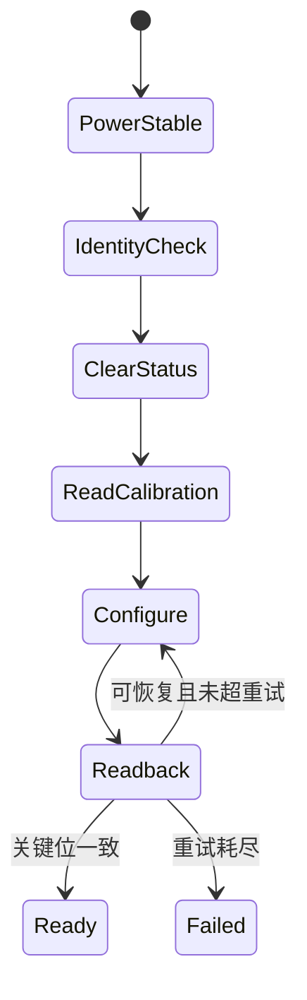
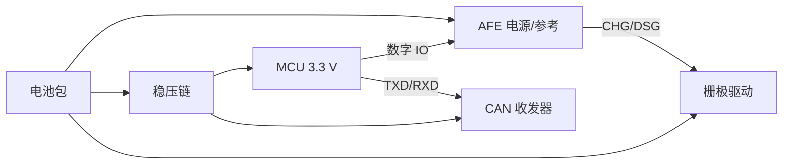

# 主控芯片选型与核心芯片使用：40 道递进面试题

本文面向嵌入式校招面试，话题严格限定在两件事：

1. BMS 主控 MCU 如何选、片上资源如何正确使用；
2. AFE、Fuel Gauge、MOS 驱动器、CAN 收发器等核心器件如何选、如何接、如何 Bring-up。

题目不要求候选人预先阅读本仓库。项目代码和 Research 记录只用于校准答案、准备面试官追问，
不作为记忆题材料。

## 本篇边界

| 本篇会问 | 留给其他面试文档 |
|---|---|
| MCU 主频、Flash、RAM、封装、引脚和外设选型 | BMS 保护策略和 SOC/SOH 算法设计 |
| 时钟树、复位、DMA、片内 Flash 和 GPIO 安全状态 | CAN/UART 应用层报文和升级协议 |
| BQ76940 供电、地址、CRC、寄存器、ADC 和 CHG/DSG | RTOS 调度、优先级、线程同步 |
| BQ34Z100、BQ76200、CAN 收发器的器件职责与电气接入 | 项目任务架构、数据流和任务间通信 |
| 芯片级上电、波形、寄存器回读和故障定位 | 高压平台、OTA、云端等扩展功能实现 |

保护寄存器、均衡位和电流/温度换算会涉及，但只考“芯片怎样配置和证明配置生效”。

## 使用方式

- 问题区连续列出 Q1～Q40，答案集中在 Q40 之后。
- 每题包含一个现场追问，用于区分背概念和真正做过。
- 初级看概念，中级看计算与操作，高级看边界、证据和选型取舍。
- 优秀回答应包含假设、数字、数据手册依据和验证方法，而不只是报出芯片型号。

---

## 问题区

### 子话题一：MCU 选型方法

<a id="q1"></a>
#### Q1【初级】现在要为一款低压 BMS 选择 MCU。你会先向产品和硬件人员确认哪些需求？

面试官追问：哪些需求会直接改变 MCU 型号，哪些通常只是软件参数变化？

[参考答案 A1](#a1)

<a id="q2"></a>
#### Q2【初级】选 MCU 时，主频、Flash、RAM、外设和引脚这五项分别解决什么问题？为什么不能只比较主频？

面试官追问：一颗 168 MHz MCU 一定比 72 MHz MCU 更适合这个 BMS 吗？

[参考答案 A2](#a2)

<a id="q3"></a>
#### Q3【初级】Cortex-M0/M0+、M3、M4F 都能运行控制程序。你会根据什么判断内核档位，而不是默认选择“性能最高”的？

面试官追问：没有 FPU 会怎样影响芯片选择？

[参考答案 A3](#a3)

<a id="q4"></a>
#### Q4【中级】候选 MCU 标称 72 MHz。你如何估算它能否按期完成采样、换算和外设收发？

面试官追问：项目尚未完成时，怎样得到比“应该够用”更可信的结论？

[参考答案 A4](#a4)

<a id="q5"></a>
#### Q5【中级】项目还在早期，你如何估算所需 Flash 和 RAM，并为后续功能保留余量？

面试官追问：调用栈、DMA 缓冲、静态对象和片内参数区分别占用什么资源？

[参考答案 A5](#a5)

<a id="q6"></a>
#### Q6【中级】需求有 CAN、调试串口、AFE 接口、晶振、SWD 和若干 GPIO。你如何做封装与引脚复用审查？

面试官追问：外设实例数量够用，为什么仍可能在画原理图时失败？

[参考答案 A6](#a6)

<a id="q7"></a>
#### Q7【中级】除了电气参数，你会怎样评审 MCU 的温区、生命周期、供货、开发工具和量产可测试性？

面试官追问：同系列芯片引脚兼容，是否就代表可以无风险替换？

[参考答案 A7](#a7)

<a id="q8"></a>
#### Q8【高级】请比较 STM32F103C8、同系列更大存储型号和一颗更新的 MCU，给出选择矩阵以及明确的升级触发条件。

面试官追问：怎样避免“只选最便宜”和“为了先进而升级”两种极端？

[参考答案 A8](#a8)

### 子话题二：STM32F103 片上资源使用

<a id="q9"></a>
#### Q9【初级】外部 8 MHz 晶振如何让 STM32F103 运行到 72 MHz？请口述主要时钟路径。

面试官追问：APB1 为什么不能直接跑到 72 MHz？

[参考答案 A9](#a9)

<a id="q10"></a>
#### Q10【初级】HSE、HSI 和 PLL 各有什么作用？真机与仿真平台使用不同系统时钟时，哪些代码不能写死？

面试官追问：怎样证明真机实际运行频率确实是 72 MHz？

[参考答案 A10](#a10)

<a id="q11"></a>
#### Q11【中级】PA11/PA12 用于 CAN、PB8/PB9 用于 AFE、PA13～PA15 涉及调试接口。你会如何检查复用与重映射冲突？

面试官追问：为什么释放 JTAG 引脚时要特别小心，不能顺手把 SWD 也关掉？

[参考答案 A11](#a11)

<a id="q12"></a>
#### Q12【中级】STM32F103 已经带 CAN 控制器，为什么仍需要外部 CAN 收发器？选收发器时要核对哪些电气参数？

面试官追问：MCU 内部 CAN 自环通过，能否证明板上的 CAN 接口可用？

[参考答案 A12](#a12)

<a id="q13"></a>
#### Q13【中级】AFE 通信可以使用硬件 I2C，也可以使用 GPIO 模拟 I2C。你会怎样选择？

面试官追问：软件 I2C 能工作，为什么仍可能成为量产风险？

[参考答案 A13](#a13)

<a id="q14"></a>
#### Q14【高级】STM32F103 的 DMA 请求与通道映射基本固定。你会怎样审查 UART、ADC 等外设的 DMA 需求和通道冲突？

面试官追问：哪些传输值得使用 DMA，哪些短事务使用 DMA 反而得不偿失？

[参考答案 A14](#a14)

<a id="q15"></a>
#### Q15【高级】STM32F103 的上电复位、欠压复位、NRST 外部复位和软件复位有什么区别？关键控制引脚在复位期间应处于什么状态？

面试官追问：怎样读取并保存复位原因，证明设备为何重新启动？

[参考答案 A15](#a15)

<a id="q16"></a>
#### Q16【高级】需要把标定参数保存在 STM32F103 片内 Flash。页擦除、写入粒度、寿命和掉电会怎样影响设计？

面试官追问：直接在原地址覆盖一个配置结构体，为什么可能得到不可恢复的半写数据？

[参考答案 A16](#a16)

### 子话题三：BQ76940 选型与基础接口

<a id="q17"></a>
#### Q17【初级】面对 5S、9S 和 15S 电池包，你会怎样在 BQ76920、BQ76930、BQ76940 或其他 AFE 中选择？

面试官追问：通道数覆盖目标串数，是否就代表 AFE 选型完成？

[参考答案 A17](#a17)

<a id="q18"></a>
#### Q18【初级】为什么多串电芯通常需要 AFE，而不能把每个抽头经电阻分压后直接接 MCU ADC？

面试官追问：片内 ADC 在 BMS 板上还有哪些合理用途？

[参考答案 A18](#a18)

<a id="q19"></a>
#### Q19【初级】BQ76940 有 15 个电芯通道，9S 电池包为什么可能使用不连续的 VC 通道？软件要保存什么映射？

面试官追问：映射错误会同时影响哪些芯片功能？

[参考答案 A19](#a19)

<a id="q20"></a>
#### Q20【中级】拿到 BQ76940 新板，你会先核对哪些供电、参考地、外部电容和上电条件，再开始写驱动？

面试官追问：MCU 已能读到 ACK，能否说明 AFE 模拟部分已经正常？

[参考答案 A20](#a20)

<a id="q21"></a>
#### Q21【中级】BQ76940 的 7 位地址、写地址字节和读地址字节是什么关系？为什么驱动中常见 `0x08`、`0x10`、`0x11` 三个值？

面试官追问：把 8 位地址直接传给期望 7 位地址的 I2C API 会发生什么？

[参考答案 A21](#a21)

<a id="q22"></a>
#### Q22【中级】BQ76940 的通信 CRC 应怎样实现和验证？你不会只靠“抄一段 CRC 函数”吧？

面试官追问：读操作第一个数据字节与后续数据字节的 CRC 输入为什么可能不同？

[参考答案 A22](#a22)

<a id="q23"></a>
#### Q23【高级】请设计 BQ76940 从上电到可采样的初始化顺序，并说明哪些关键位必须读回。

面试官追问：重试结束后 ADC_EN 仍未置位，初始化函数能否继续返回成功？

[参考答案 A23](#a23)

<a id="q24"></a>
#### Q24【高级】BQ76940 的电芯 ADC 原始码如何换算成 mV？为什么必须读取器件的 ADCGAIN 和 ADCOFFSET？

面试官追问：怎样验证整数换算没有溢出、截断和单位错误？

[参考答案 A24](#a24)

### 子话题四：BQ76940 测量与控制功能

<a id="q25"></a>
#### Q25【初级】BQ76940 通过分流器测量电流时，原始码、LSB、分流器阻值和最终 mA 之间是什么关系？

面试官追问：分流器阻值选得过大或过小分别会怎样？

[参考答案 A25](#a25)

<a id="q26"></a>
#### Q26【初级】10k NTC 接到 BQ76940 的 TS 通道后，软件怎样从 ADC 值得到温度？

面试官追问：怎样从电气读数识别 NTC 开路或短路？

[参考答案 A26](#a26)

<a id="q27"></a>
#### Q27【中级】把多次单寄存器读取改成 burst 后，电压值看起来正常但实际错误。你首先检查什么？

面试官追问：为什么 BQ76940 的 30 字节有效数据可能需要 60 字节接收缓冲区？

[参考答案 A27](#a27)

<a id="q28"></a>
#### Q28【中级】实测充电时 BQ76940 原始电流为正，而产品软件约定充电为负。符号转换应放在哪里？`CC_READY` 应如何处理？

面试官追问：为什么不能让各个调用方自行决定是否取反？

[参考答案 A28](#a28)

<a id="q29"></a>
#### Q29【中级】写入 `SYS_CTRL2` 的 CHG/DSG 位后，怎样逐级证明外部 MOS 真的按预期导通或关断？

面试官追问：寄存器读回正确但主回路仍不断开，可能有哪些芯片外原因？

[参考答案 A29](#a29)

<a id="q30"></a>
#### Q30【中级】使用 BQ76940 的硬件过压、欠压、过流和短路功能时，驱动初始化至少应完成哪些配置与回读？

面试官追问：只看寄存器回读是否足够？你如何证明写入的阈值在器件上真实生效？

[参考答案 A30](#a30)

<a id="q31"></a>
#### Q31【高级】BQ76940 的 CELLBAL 寄存器怎样对应物理通道？实现底层均衡控制时要防止哪些寄存器级错误？

面试官追问：软件逻辑电芯编号与物理 VC 通道不连续时，均衡位怎样转换？

[参考答案 A31](#a31)

<a id="q32"></a>
#### Q32【高级】新板上电后，所有电芯电压和温度都是 0，但电流通道有数据。请从 BQ76940 内部功能分区推导排查路径。

面试官追问：这个现象为什么比“所有数据都为 0”更有定位价值？

[参考答案 A32](#a32)

### 子话题五：配套核心器件与芯片级验证

<a id="q33"></a>
#### Q33【初级】BQ76940 与 BQ34Z100-G1 的职责有什么不同？一块板是否一定需要同时使用两者？

面试官追问：为什么焊上一颗 Fuel Gauge 不会自动得到准确 SOC？

[参考答案 A33](#a33)

<a id="q34"></a>
#### Q34【中级】BQ76200 一类高边 N-MOS 驱动器解决什么问题？接入前要检查哪些电压、时序和默认状态？

面试官追问：它与 BQ76940 的 CHG/DSG 输出是什么关系？

[参考答案 A34](#a34)

<a id="q35"></a>
#### Q35【中级】为 STM32F103 的 CAN 控制器选择外部收发器时，你会核对供电、逻辑电平、终端、待机和 ESD 哪些条件？

面试官追问：TJA1050 能收发并不代表它一定是新设计的最佳选择，为什么？

[参考答案 A35](#a35)

<a id="q36"></a>
#### Q36【中级】分流器、NTC 上拉电阻和 AFE 输入滤波器虽然不是“大芯片”，为什么会决定测量芯片能否达到手册精度？

面试官追问：你会怎样把这些外围参数纳入误差预算和台架验证？

[参考答案 A36](#a36)

<a id="q37"></a>
#### Q37【高级】请审查 MCU、AFE、CAN 收发器和栅极驱动器的电源树。你会重点核对哪些电压、上电顺序、静态电流和掉电状态？

面试官追问：为什么“MCU 能启动”远不能证明整条芯片电源链可靠？

[参考答案 A37](#a37)

<a id="q38"></a>
#### Q38【高级】候选核心芯片参数满足，但价格波动大且存在停产风险。你如何准备替代料并控制驱动迁移风险？

面试官追问：寄存器兼容或引脚兼容，哪一个都不能单独证明可替换，为什么？

[参考答案 A38](#a38)

<a id="q39"></a>
#### Q39【高级】你简历写“负责 STM32F103 与 BQ76940 驱动”。请选择一次真正由你主导的芯片 Bring-up 或故障定位，按证据链讲清楚。

面试官追问：你改了什么、怎样证明根因、怎样证明修复没有引入新错误，还有什么没完成？

[参考答案 A39](#a39)

<a id="q40"></a>
#### Q40【高级】芯片选型题：为一款 48 V 低压 BMS 给出 MCU、AFE、Fuel Gauge、MOS 驱动器和 CAN 收发器的候选组合与取舍。

面试官追问：请只用芯片能力、资源预算、电气接口和验证证据证明选择。

[参考答案 A40](#a40)

---

## 集中参考答案

### 子话题一答案：MCU 选型方法

<a id="a1"></a>
### A1

**面试官在听什么：** 候选人是否先建立选型输入，而不是报出自己熟悉的型号。

**参考答案：** 至少确认以下信息：

| 需求 | 会影响的 MCU 条件 |
|---|---|
| 电芯串数、采样周期、核心芯片数量 | 接口类型、总线数量与吞吐 |
| CAN/UART/调试/升级接口 | 外设实例、DMA、引脚和 Flash |
| 计算内容与周期 | 内核、主频、FPU 和 RAM |
| 固件、日志、参数区 | Flash 容量与分区 |
| 正常/峰值功耗、休眠电流 | 低功耗模式与唤醒引脚 |
| 温区、寿命、质量等级 | 器件等级、可靠性与供应链 |
| 封装尺寸、成本、年产量 | 封装、价格与可制造性 |

双 CAN、FDCAN、较大的固件与片内数据、宽温和质量等级可能直接改变型号。保护阈值、
电芯数量在 AFE 能力范围内时，通常更多影响配置而不是 MCU 内核。

候选人还应主动说明哪些需求未知，以及会用什么临时假设继续比较。面试官不期待一分钟报出
唯一料号，期待的是完整的选型输入清单。

[返回 Q1](#q1)

<a id="a2"></a>
### A2

**面试官在听什么：** 是否理解 MCU 数据手册中的资源项对应什么工程问题。

**参考答案：**

- 主频决定单位时间可执行的工作上限，但总线等待和阻塞外设可能才是瓶颈；
- Flash 放代码、常量和只读配置；
- RAM 放全局可写数据、栈、队列和外设缓冲；
- 外设决定是否能硬件实现 CAN、I2C、UART、定时器和电源监控；
- 引脚与封装决定这些外设能否同时引出并满足电气要求。

168 MHz 不一定更合适。若采样瓶颈是 100 kHz I2C，换更高主频不会线性提速，却可能增加
成本、功耗、PCB 和工具迁移工作。反过来，72 MHz 也不能仅凭“BMS 很慢”判断够用，仍需
做时序和存储预算。

成熟回答会把“够用”量化为：关键操作最坏时间、Flash/RAM 峰值、外设冲突和至少一个版本
的增长余量。

[返回 Q2](#q2)

<a id="a3"></a>
### A3

**面试官在听什么：** 是否根据真实计算和外设需求选择内核。

**参考答案：** M0/M0+ 适合成本和功耗敏感、计算较轻的控制；M3 具备较完整的中断与 32 位
能力；M4/M4F 增加 DSP 指令，M4F 还提供单精度 FPU。内核只是选型的一项，还要结合厂商
外设、存储、工具和质量等级。

没有 FPU 并不妨碍电压、电流和温度换算。可以使用 mV、mA、0.1 摄氏度等整数单位，并用
64 位中间值避免乘法溢出。只有当换算、标定或芯片厂商库大量使用浮点且测得软浮点无法满足
周期，FPU 才成为明确的升级理由。

面试官可继续要求候选人给出一个物理量的范围、单位和中间值宽度，以判断他是真的理解数值
设计，还是只会说“定点更快”。

[返回 Q3](#q3)

<a id="a4"></a>
### A4

**面试官在听什么：** 是否会用时间预算代替主频直觉。

**参考答案：**

```text
T_total =
    总线事务时间
  + CRC/换算时间
  + 外设收发与中断开销
  + 最坏抢占和等待

要求：T_total_worst < 规定周期，并保留余量
```

早期可由总线速率、预计事务字节数、算法操作量和相似工程测量建立保守预算。原型出来后用
cycle counter、GPIO 翻转、逻辑分析仪和统计日志测平均、P99 与最坏值。

项目中一次 BQ 采样的大量时间花在位翻转 I2C 和逐寄存器事务，而不是 CPU 算术。这个案例
说明高主频不能掩盖接口方式不合理。驱动实现见
[bq769x0_core.c](../../firmware/drivers/afe/bq769x0_core.c)。

好答案还会区分“CPU 空闲率”和“关键操作截止时间”：平均负载很低，仍可能因一次长阻塞而
超时。

[返回 Q4](#q4)

<a id="a5"></a>
### A5

**面试官在听什么：** 是否能把链接占用和运行峰值分开。

**参考答案：**

- Flash：应用代码、常量、芯片驱动、参数页和预留空间；
- RAM：`.data/.bss`、主栈、各执行上下文栈、DMA/串口缓冲和临时计算区；
- 调用栈和缓冲要按最坏嵌套、日志和错误路径测量，不只看正常工况。

早期可按模块估算并留增长余量；集成后用 ELF/map、`size`、栈水位和压力测试替代估算。
片内参数区、校准区等保留空间也必须从可用 Flash 中扣除，不能用整片容量减当前 ELF。

当前硬件构建中，应用装载约 `40068/60416 B`，RAM 约 `12068/20480 B`。这些数字能说明
STM32F103C8 当前版本可运行，但不能自动证明后续功能仍有余量。实际可用空间应结合
[硬件构建配置](../../firmware/hw.conf)与链接产物核对。

[返回 Q5](#q5)

<a id="a6"></a>
### A6

**面试官在听什么：** 是否会从外设实例走到具体封装和复用表。

**参考答案：** 建立资源矩阵：

```text
功能 -> 外设实例 -> 候选引脚 -> 复用/重映射 -> 电压能力 -> 冲突
```

逐项检查目标封装是否引出引脚，晶振、BOOT、SWD/JTAG 是否占用，是否需要 remap，输入是否
5 V 容忍，输出速度和驱动能力是否满足外围器件。还要保留测试点和量产烧录接口。

外设实例数量够但仍失败的常见原因是：两个外设只能映射到同一引脚；小封装没有目标引脚；
调试口占用；某输入不是 5 V tolerant；或者重映射后 PCB 已接到旧位置。

本项目引脚事实集中在 [pinmap.json](../../docs/board-facts/pinmap.json)，设备树见
[app.overlay](../../firmware/app.overlay)。面试考察的是候选人如何得到这份表，不是背表。

[返回 Q6](#q6)

<a id="a7"></a>
### A7

**面试官在听什么：** 是否具备量产器件意识。

**参考答案：** 除参数外，应检查：

- 工作温区、ESD、EMC 相关能力和质量等级；
- 厂商生命周期、PCN/停产政策、授权渠道和交期；
- 编译器、调试器、烧录器、量产工具与长期维护；
- 封装焊接、AOI、测试点、芯片唯一 ID 和故障追溯；
- 驱动库质量、勘误数量与厂商支持。

同系列引脚兼容不代表无风险替换。Flash/RAM、启动选项、时钟限制、外设实例、寄存器默认值、
芯片修订版和 Flash 擦写粒度都可能不同。替换后仍要重新构建、读芯片 ID、验证时钟、
外设和量产烧录。

可靠的选型文档应记录器件状态核对日期和替代料，不应只保存一次价格截图。

[返回 Q7](#q7)

<a id="a8"></a>
### A8

**面试官在听什么：** 是否能用门槛与触发条件作决策。

**参考答案：** 先设硬门槛：温区、封装、CAN、Flash/RAM 下限、调试和供货任一不满足就
淘汰。再对成本、生态、功耗、DMA、FDCAN、迁移工作量加权评分。

| 方案 | 适合情况 | 主要风险 |
|---|---|---|
| STM32F103C8 | 当前功能明确、成本敏感、已有软硬件 | 64 KiB Flash 和 20 KiB RAM 较紧 |
| 同系列更大存储 | 希望最低迁移成本地获得余量 | 外设和内核能力没有本质升级 |
| 更新 MCU | 需要更多存储、FDCAN、低功耗或安全能力 | 驱动、启动代码和硬件重新验证 |

升级触发条件可定义为：Flash 连续版本超过分区 75%～80%；栈余量低于门槛；需要双镜像、
FDCAN/双 CAN；关键操作无法保留时序余量；质量等级或生命周期不满足。

选型结论必须带“为什么现在不升级”和“什么情况下必须升级”。STM32F103C8 的当前产品状态
应以 [ST 官方页面](https://www.st.com/en/microcontrollers-microprocessors/stm32f103c8.html)
为准。

[返回 Q8](#q8)

### 子话题二答案：STM32F103 片上资源使用

<a id="a9"></a>
### A9

**面试官在听什么：** 是否理解时钟树，而不只是记住 72 MHz。

**参考答案：**

```text
HSE 8 MHz
  -> PLL 输入
  -> PLL x9
  -> SYSCLK 72 MHz
  -> AHB 72 MHz
  -> APB1 36 MHz
  -> APB2 72 MHz
```

STM32F103 的 APB1 有最大频率限制，因此通常分频到 36 MHz；CAN 等 APB1 外设据此计算
时序。定时器时钟在 APB 分频不为 1 时还可能自动乘 2，不能简单把所有外设都当作 72 MHz。

回答时应区分时钟源、PLL、系统时钟、总线时钟和外设时钟。当前真机配置见
[hw.overlay](../../firmware/hw.overlay)，构建配置应核对 `CONFIG_SYS_CLOCK_HW_CYCLES_PER_SEC`
与实际时钟树一致。

[返回 Q9](#q9)

<a id="a10"></a>
### A10

**面试官在听什么：** 是否知道时钟差异会传播到所有时间相关代码。

**参考答案：** HSI 是片内 RC，启动快但精度有限；HSE 使用外部晶振，精度和稳定性通常更好；
PLL 对输入倍频生成高系统时钟。真机可用 HSE+PLL，仿真平台为了模型简单可能使用 HSI。

延时、串口波特率、CAN 位时序、定时器和 cycle counter 都不能基于手写常数假设时钟。应由
时钟驱动和设备配置提供频率。

证明 72 MHz 可使用：

1. 读取时钟配置寄存器并计算；
2. 用 MCO 输出内部时钟后示波器测量；
3. 配置定时器或 cycle counter 产生已知周期 GPIO；
4. 核对串口/CAN 实际波形。

项目真机和仿真模型的时钟差异记录在
[硬件设备树](../../firmware/hw.overlay)与
[仿真配置](../../firmware/app.overlay)中，跨平台代码应使用统一时间 API。

[返回 Q10](#q10)

<a id="a11"></a>
### A11

**面试官在听什么：** 是否会保护调试通道并验证复用结果。

**参考答案：** 先查目标封装的数据手册与 AFIO remap 表，列出 CAN、I2C、JTAG/SWD 的默认
和重映射引脚，再与原理图逐网核对。软件使能 remap 后应读取 AFIO 配置，并在对应引脚观察
真实波形。

PA13/PA14 通常用于 SWD，PA15/PB3/PB4 可能被完整 JTAG 占用。若需要 PA15 等 GPIO，应
关闭 JTAG 但保留 SWD，而不是禁用整个调试端口。否则一次配置错误就可能让后续调试和救砖
困难。

还要检查上电默认状态：外设初始化前引脚可能是高阻输入，外部上下拉必须让 AFE、收发器和
功率控制保持安全状态。

[返回 Q11](#q11)

<a id="a12"></a>
### A12

**面试官在听什么：** 是否区分协议控制器与物理层器件。

**参考答案：** STM32 bxCAN 产生/解析 CAN 帧、位时序和错误状态；外部收发器把 TXD/RXD
逻辑电平转换成差分 CANH/CANL，并承受总线共模、ESD 和瞬态。

选收发器时核对：

- 3.3 V MCU 与收发器 TXD/RXD 阈值和输出电压；
- 收发器供电、待机/静默引脚和上电默认状态；
- CAN 速率、共模范围、总线故障保护和 ESD；
- 是否需要汽车质量等级、低功耗唤醒或分裂终端；
- 120 欧终端的位置和数量。

内部自环绕过收发器、连接器、终端和线束，只能证明 CAN 控制器基本工作。必须再做外部节点
收发和示波器差分波形验证。

[返回 Q12](#q12)

<a id="a13"></a>
### A13

**面试官在听什么：** 是否能解释软件模拟总线的使用边界。

**参考答案：**

- 硬件 I2C 通常具有稳定时序、较低 CPU 占用、中断/DMA 和标准错误状态；
- 软件 I2C 引脚灵活、便于绕开复用冲突和调试特殊时序，但延时依赖 CPU/编译器，容易被
  中断拉长，并需要自己处理开漏、ACK、clock stretching、超时和总线恢复。

选择取决于引脚、芯片时序、外设勘误、实时预算和维护成本。软件 I2C 若用于量产，必须验证
最低/最高温、不同优化等级、中断负载、上拉边沿、从机拉低和 SDA 卡死恢复。

本项目 PB8/PB9 使用 GPIO 位翻转连接 BQ76940，是板级约束下的实现，不代表软件 I2C 普遍
优于硬件 I2C。实现见 [bq769x0_core.c](../../firmware/drivers/afe/bq769x0_core.c)。

[返回 Q13](#q13)

<a id="a14"></a>
### A14

**面试官在听什么：** 是否真正查过 DMA 映射表，并会识别硬件资源冲突。

**参考答案：** 先从参考手册列出每个外设请求对应的 DMA 控制器、通道和方向，再与引脚矩阵
一样建立资源表。STM32F103 的 DMA 请求通常不是任意路由，两个同时工作的外设若占用同一
通道，就必须调整外设实例、改变使用时序，或让其中一个不使用 DMA。

- ADC 连续批量采样、UART 长数据块适合 DMA；
- 极短、低频事务可能使用轮询或中断更简单；
- CAN 帧由邮箱机制收发，不能想当然地套用 UART DMA；
- GPIO 模拟 I2C 没有硬件 I2C 的 DMA 请求，需先解决接口本身。

DMA 不是免费的：存在通道配置、完成标志、缓冲区对齐、长度边界和错误清理。验证要同时测
传输完成时间、CPU cycle、通道冲突和错误后再次启动，而不是只证明正常路径收到数据。

[返回 Q14](#q14)

<a id="a15"></a>
### A15

**面试官在听什么：** 是否理解复位源、复位期间引脚状态和外部安全偏置。

**参考答案：** 上电/掉电复位在电源跨过门槛时保持内核复位；欠压复位防止 MCU 在不可靠
电压执行；NRST 由外部电路或调试器拉低；软件复位由内核请求触发。不同复位源是否复位备份
域和具体外设，要查参考手册，不能凭名称推断。

启动后应在清标志前读取 RCC 复位原因，连同启动计数保存到可靠区域或输出到诊断口。台架分别
做慢上电、快速掉电、NRST 脉冲和软件复位，确认原因位与预期一致。

复位期间 GPIO 多为高阻输入，因此 CHG/DSG、收发器使能等关键控制不能依赖软件“尽快初始化”，
要用外部上下拉保证安全默认电平，并核对外设接管引脚前是否出现毛刺。

[返回 Q15](#q15)

<a id="a16"></a>
### A16

**面试官在听什么：** 是否理解片内 Flash 不是可任意覆盖的字节数组。

**参考答案：** STM32F103 Flash 需要按允许宽度编程，位通常只能从 1 写成 0；要恢复 1
必须整页擦除。擦写期间还要遵守忙状态、供电和执行限制，并考虑有限擦写寿命。因此参数区应
与程序区隔离，按页布局，避免每次小变化都擦同一页。

可靠记录可包含：

```text
magic | schema_version | sequence | length | payload | crc | valid_marker
```

使用两页或多槽轮换：先把新记录完整写入空槽，读回并校验 CRC，最后写有效标记；确认新记录
有效后再回收旧页。上电选择序号最新且校验通过的记录。这样掉电发生在任一步，都至少保留一份
可识别的旧数据。

验证要在每个写入阶段切断电源，覆盖页满、序号回绕、CRC 错和版本迁移，并统计最坏写入频率
是否满足器件擦写寿命。

[返回 Q16](#q16)

### 子话题三答案：BQ76940 选型与基础接口

<a id="a17"></a>
### A17

**面试官在听什么：** 是否会从串数继续审查模拟与保护能力。

**参考答案：** BQ769x0 家族首先按支持串数筛选：较少串数选对应型号，9S 通常落在中间或
更高通道型号范围，15S 需要覆盖 15 通道的器件。具体选择还要检查：

- 单体输入与总共模范围；
- ADC 精度、增益/偏移和温度通道；
- 电流检测、硬件保护和均衡能力；
- CHG/DSG 输出方式；
- 通信 CRC、ALERT、休眠和唤醒；
- 温区、封装、生命周期和成本。

使用大于实际串数的 AFE 时，必须按手册连接空通道，并验证映射、开线与均衡。若新项目需求
包含更高集成高边驱动或开线诊断，也应比较更新 AFE，而不是因为已有驱动就固定选旧型号。

[返回 Q17](#q17)

<a id="a18"></a>
### A18

**面试官在听什么：** 是否理解多串测量的共模与安全问题。

**参考答案：** 串联电芯抽头相对 MCU 地的电压逐节升高，不能当作多路 0～3.3 V 输入。
简单分压还会带来累计容差、漏电、地线压降、输入保护、不同步采样、开线诊断和长期耗电。

AFE 在电池侧完成高共模采样、校准、电流/温度接口、部分硬件保护和均衡控制，MCU 通过低压
数字接口读取结果。

MCU ADC 仍可测量辅助电源、板温、低压传感器或隔离后的 PACK 信号，也可作为独立合理性
检查。好答案应画出最高抽头相对地电压，说明绝对最大额定与正常量程的区别，而不只说
“MCU ADC 通道不够”。

[返回 Q18](#q18)

<a id="a19"></a>
### A19

**面试官在听什么：** 是否把物理通道映射作为芯片使用契约。

**参考答案：** AFE 内部通道常按电源分组，少串连接需遵守手册推荐，不能任意把 9 节连续
接到 VC1～VC9。软件要保存：

```text
logical_cell -> physical_VC -> 寄存器地址 -> CELLBAL 位
```

同一份映射必须用于电压读取、最高最低统计、均衡控制、开线检查和诊断显示。启动时验证数量、
范围、唯一性；台架上逐通道改变输入并确认逻辑编号。

本项目 9 个逻辑电芯映射到物理通道 `1,2,5,6,7,10,11,12,15`，配置见
[app.overlay](../../firmware/app.overlay)和
[bq76940_config.json](../../docs/board-facts/bq76940_config.json)。

[返回 Q19](#q19)

<a id="a20"></a>
### A20

**面试官在听什么：** 是否先完成模拟与供电核查，再写寄存器。

**参考答案：** 按数据手册和参考设计核对：

- BAT/REGSRC/REGOUT 等电源路径、去耦和启动条件；
- 各 VC 分组供电与输入滤波，空通道接法；
- SRP/SRN 分流器 Kelvin 连接；
- TS 上拉与 NTC 网络；
- CAP1/CAP2/CAP3 等外部电容的容量、耐压和布局；
- ALERT、SDA/SCL 上拉电压和开漏连接；
- CHG/DSG 默认上下拉与外部驱动关系。

ACK 只证明数字接口的部分电源和地址可能正常，不能证明 ADC 分组供电、参考电容、电芯输入
和电流通道正确。应测各电源轨、读复位寄存器，并用已知输入逐项验证。

板级核对结果见 [bms_board_facts.md](../../docs/board-facts/bms_board_facts.md)。

[返回 Q20](#q20)

<a id="a21"></a>
### A21

**面试官在听什么：** 是否区分 7 位从机地址与线上地址字节。

**参考答案：** I2C 常用 7 位地址 `0x08`。线上发送的第一个地址字节是：

```text
write_byte = (0x08 << 1) | 0 = 0x10
read_byte  = (0x08 << 1) | 1 = 0x11
```

不同 API 有的接收 7 位地址并内部移位，有的底层函数直接发送 8 位地址字节。驱动必须明确
接口约定，不能因为三个数都出现在代码中就认为互相矛盾。

把 `0x10` 传给期望 7 位地址的 API 后，它还会左移，线上地址将错误，从机不 ACK。调试时用
逻辑分析仪直接看地址字节和 R/W 位最有效。

项目的地址事实见
[bq76940_config.json](../../docs/board-facts/bq76940_config.json)。

[返回 Q21](#q21)

<a id="a22"></a>
### A22

**面试官在听什么：** 是否能从数据手册重新推导 CRC 覆盖范围。

**参考答案：** BQ76940 使用多项式 `0x07` 的 CRC-8，但“多项式相同”不足以证明实现正确。
还要确认初值、移位方向、是否反射、输入顺序和每个字节的 CRC 边界。

写寄存器时 CRC 通常覆盖地址字节、寄存器地址与数据。读操作的第一个数据字节可能覆盖写
地址、寄存器地址、读地址和数据；连续后续字节则按手册定义覆盖相应数据。必须逐帧对照手册，
不能把整段缓冲统一套一个 CRC。

验证方法：

1. 使用手册或 Research 中已知向量；
2. 对同一字节流用独立脚本交叉计算；
3. 捕获真实总线并离线复算；
4. 翻转每个输入位，确认错误能被拒绝。

当前实现入口见 [bq769x0_core.c](../../firmware/drivers/afe/bq769x0_core.c)。

[返回 Q22](#q22)

<a id="a23"></a>
### A23

**面试官在听什么：** 是否把初始化做成“写入、读回、失败退出”的闭环。

**参考答案：**



初始化至少确认通信、器件状态、ADC 校准、ADC_EN、温度使能、保护寄存器、均衡关闭和
CHG/DSG 安全初值。关键配置写后读回，错误要区分 NACK、CRC、超时和值不一致。

重试耗尽后关键位仍错误，必须返回失败，不能让上层把全 0 测量当有效数据。当前
[bq769x0_init](../../firmware/drivers/afe/bq769x0_core.c) 对 ADC_EN 有重试，但最终失败出口
仍值得加强，这可作为现场代码追问。

[返回 Q23](#q23)

<a id="a24"></a>
### A24

**面试官在听什么：** 是否能把手册公式写成可靠的整数代码。

**参考答案：**

```text
cell_uV = raw * gain_uV_per_LSB + offset_mV * 1000
cell_mV = round(cell_uV / 1000)
```

增益和偏移来自 ADCGAIN/ADCOFFSET 寄存器，反映每颗芯片的校准差异。使用典型增益常数会把
个体误差带入所有单体电压。

实现时使用足够宽的有符号中间值，先乘后加，最后带舍入除法；明确 raw、uV、mV 的单位。
测试覆盖原始码 0、满量程、最大/最小增益、正负偏移和舍入边界。台架再给每个通道施加多个
精密电压点，与 DMM 比较。

换算实现见 [bq769x0_core.c](../../firmware/drivers/afe/bq769x0_core.c)，面试时应让候选人
现场写出单位，而不是背公式常数。

[返回 Q24](#q24)

### 子话题四答案：BQ76940 测量与控制功能

<a id="a25"></a>
### A25

**面试官在听什么：** 是否会同时检查量程、分辨率和分流器功耗。

**参考答案：** AFE 电流 ADC 得到有符号原始码，乘以数据手册规定的 CC LSB 得到分流器
差分电压，再除以分流器阻值得到电流：

```text
Vshunt = raw * CC_LSB
I = Vshunt / Rshunt
```

单位要统一，例如 uV、mΩ 最终对应 mA。分流器过大可提高小电流分辨率，却增加压降、持续
发热和短路脉冲能量；过小则使零点偏移和噪声占比增大。

选型还要检查最大输入量程、持续功耗 `I²R`、脉冲耐量、温漂和四线 Kelvin 采样。验证覆盖
零电流、双向已知电流、峰值电流与热稳定。

[返回 Q25](#q25)

<a id="a26"></a>
### A26

**面试官在听什么：** 是否理解 TS 电压、NTC 阻值与温度之间的完整链路。

**参考答案：** 先把 TS ADC 值换成电压，再按上拉网络求 NTC 阻值：

```text
Rntc = Rpullup * Vntc / (Vref - Vntc)
```

然后使用 Beta/Steinhart-Hart 公式、查表或分段线性得到温度。资源受限且温区固定时，离线
生成整数查表更容易验证；使用公式时要考虑浮点开销和系数精度。

NTC 开路通常使输入逼近参考端，短路使输入逼近地，但必须根据实际接法与手册确认。诊断阈值
要避开正常极端温度，并验证上拉容差、B 值误差和 ADC 误差。

项目使用 10k/B3380 NTC 与整数查表，代码见
[bms_ntc.c](../../firmware/drivers/sensor/bms_ntc.c)。

[返回 Q26](#q26)

<a id="a27"></a>
### A27

**面试官在听什么：** 是否优先检查传输帧，而不是继续调整换算公式。

**参考答案：** BQ76940 连续读取时，每个数据字节后可能紧跟一个 CRC。15 路电芯共 30 个
有效数据字节，对应接收排列可能是：

```text
data0, crc0, data1, crc1, ... data29, crc29
```

因此缓冲区需要 60 字节。若按 30 字节读取并把 CRC 当作下一数据字节，组合出的 16 位数仍
可能落在合理电压范围，造成“看起来正常”的假象。

定位时捕获波形，对照手册逐字节标注地址、数据和 CRC；再与旧的单寄存器读取在同一静态输入
下比较原始码。任何 CRC 失败都应拒绝该次数据，不用部分旧值拼接。

项目相关踩坑最终形成了正确的交错解析，见
[bq769x0_core.c](../../firmware/drivers/afe/bq769x0_core.c)。

[返回 Q27](#q27)

<a id="a28"></a>
### A28

**面试官在听什么：** 是否建立唯一的电流语义并正确区分事件位。

**参考答案：** 系统先定义唯一约定，例如“放电为正、充电为负”。若芯片原始方向相反，只在
AFE 驱动输出边界转换一次。后续显示、统计和其他模块只消费统一单位与符号，禁止各自取反。

`CC_READY` 表示库仑计新数据可读，是事件/数据就绪位，不是过流或短路故障。读取后按手册
清除，并从真正故障掩码中排除。

验证使用静置、已知充电、已知放电三种工况，同时记录原始码与转换值。项目中驱动完成符号
统一，逻辑见 [bms_bq76940.c](../../firmware/drivers/afe/bms_bq76940.c)。

[返回 Q28](#q28)

<a id="a29"></a>
### A29

**面试官在听什么：** 是否从软件命令追踪到物理功率器件。

**参考答案：** 证据强度逐级增加：

1. 写寄存器事务成功；
2. `SYS_CTRL2` 中 CHG/DSG 位读回一致；
3. AFE 输出脚电平正确；
4. 外部驱动输出与 MOS `Vgs` 正确；
5. MOS `Vds` 和主回路电流符合预期。

寄存器正确但主回路不断开，可能是驱动供电缺失、栅极开路/短路、外部上下拉错误、MOS
方向或焊接错误、MOS 击穿，或者存在充电器/通信地等旁路。

芯片驱动单元测试只能覆盖前两级，板级测试必须用示波器和受限负载覆盖后三级。回答若停在
“回读寄存器”就还没有证明核心器件真正被使用起来。

[返回 Q29](#q29)

<a id="a30"></a>
### A30

**面试官在听什么：** 是否会把保护功能落实到寄存器配置与物理验证。

**参考答案：** 初始化应根据数据手册计算并写入 `PROTECT1/2/3`、`OV_TRIP`、`UV_TRIP`
等寄存器，配置过流、短路、过压、欠压阈值和芯片支持的延时，再逐项读回。还要确认分流器
阻值、ADC 校准和电芯映射与计算输入一致。

证明生效不能只看寄存器。台架要缓慢越过电压阈值、施加受控电流脉冲，观察状态位、ALERT、
CHG/DSG 输出与实际阈值误差，并覆盖复位后配置是否保留或需要重写。

本题边界只到“芯片门槛被正确配置和触发”。当前驱动尚未完整展示上述寄存器配置与读回，
这是项目应补的芯片使用缺口。

[返回 Q30](#q30)

<a id="a31"></a>
### A31

**面试官在听什么：** 是否能处理逻辑编号、物理通道和寄存器位三层映射。

**参考答案：** BQ76940 的 CELLBAL 位对应物理 VC 通道，不对应软件数组下标。底层应通过
唯一映射把逻辑电芯请求转换为具体 CELLBAL 寄存器与位。

要防止：

- 把未使用通道或错误通道置位；
- 跨寄存器移位计算错误；
- 读改写时覆盖其他已开启位；
- 违反芯片对相邻通道或同时开启数量的限制；
- 通信失败后软件状态与寄存器状态不一致。

写入后读回，并用示波器/温升确认对应物理均衡支路动作。底层 API 还应能够一次性关闭所有
均衡位，复位和通信异常时保持安全默认值。

何时均衡、选择哪些电芯和温度策略属于算法专题，本题只考芯片位映射和执行验证。

[返回 Q31](#q31)

<a id="a32"></a>
### A32

**面试官在听什么：** 是否利用“部分功能正常”缩小芯片内部故障范围。

**参考答案：** 电流通道有数据，说明 MCU、基本总线通信、部分数字逻辑和库仑计路径可能
正常。电芯电压与 TS 同时为 0，更应聚焦它们共享的 ADC 使能、分组供电、参考电容或配置，
而不是首先怀疑 I2C 地址。

排查顺序：

1. 读取 ADC_EN、TEMP_SEL、状态和校准寄存器；
2. 检查 ADC_EN 写入后是否读回；
3. 测量相关供电、CAP 电容和 VC 输入；
4. 用单个已知通道读取原始寄存器；
5. 检查温度与电芯换算前的原始值；
6. 复位后执行最小初始化，比较寄存器差异。

“所有数据都为 0”更像总线、地址或总电源问题；部分路径正常提供了功能分区线索。好的面试
回答会利用这个不对称现象，而不是从头无差别检查全部模块。

[返回 Q32](#q32)

### 子话题五答案：配套核心器件与芯片级验证

<a id="a33"></a>
### A33

**面试官在听什么：** 是否分得清监测 AFE 与电量计。

**参考答案：** BQ76940 主要负责多串电压、电流、温度采集，硬件保护、均衡控制和 CHG/DSG
输出；BQ34Z100-G1 属于电量计，重点是库仑计量、容量学习、OCV 模型和 SOC/SOH 估算。

产品只要求基本电量显示且 MCU 资源与标定能力足够时，可以不用独立 Fuel Gauge。要求更高
容量精度、学习和电芯模型支持时，再评估增加电量计及其成本。

焊上芯片不会自动准确。还要选择匹配电芯的化学模型、配置容量和分流器、校准电压/电流/
温度、完成学习周期并设计生产烧录与参数版本管理。

本项目尚未实际接入 BQ34Z100-G1，面试中应明确它是候选扩展器件，不能把研究当成已实现。

[返回 Q33](#q33)

<a id="a34"></a>
### A34

**面试官在听什么：** 是否理解 AFE 控制位与高边栅极驱动之间的电气链。

**参考答案：** BQ76200 一类器件接收 CHG/DSG 控制，利用电荷泵驱动高边 N-MOS，使 PACK-
参考地保持连续，并可提供预充控制。接入前核对：

- BAT/PACK 最高电压与瞬态降额；
- 驱动器供电和电荷泵外部电容；
- CHG/DSG 输入电平、默认上下拉和上电时序；
- 栅极电流、MOS 总栅荷、启动/关断时间；
- 预充路径、反接行为和休眠静态电流；
- 驱动掉电或控制线开路时的默认状态。

BQ76940 的 CHG/DSG 是控制来源之一，BQ76200 提供高边驱动能力，两者不能混为同一器件。
TI [BQ76200 数据手册](https://www.ti.com/lit/ds/symlink/bq76200.pdf)可用于逐项核对。

[返回 Q34](#q34)

<a id="a35"></a>
### A35

**面试官在听什么：** 是否会从 MCU IO 一直审查到总线连接器。

**参考答案：** 选型检查：

- 供电电压与 MCU TXD 高电平门槛；
- RXD 输出最高电压是否超过 MCU 引脚允许；
- 最大速率、传播延迟和总线共模范围；
- 待机/静默/唤醒引脚及上电默认状态；
- ESD、短路、热保护和质量等级；
- 120 欧终端数量、分裂终端和共模电感需求。

还要审查器件生命周期、静态电流和是否支持产品需要的低功耗唤醒。TJA1050 是常见 5 V 高速
CAN 收发器，但新设计可能更关注 3.3 V IO、低功耗、故障保护或车规要求，不能因为“以前
能用”就停止比较。

面试回答到控制器与收发器的电气配合和实测波形为止。

[返回 Q35](#q35)

<a id="a36"></a>
### A36

**面试官在听什么：** 是否理解芯片手册精度依赖外部网络。

**参考答案：**

- 分流器阻值、温漂、焊接与 Kelvin 走线决定电流增益和零点；
- NTC、上拉电阻、参考电压和自热决定温度误差；
- VC 输入串阻、电容、漏电和布局影响采样建立时间与滤波；
- 去耦和参考电容的容值、ESR、耐压及回流路径影响 ADC 噪声。

误差预算应把芯片 ADC 误差、外围容差、温漂、布局压降和软件舍入按最坏情况或 RSS 方法合成，
再与产品允许误差比较。台架验证使用精密电压源、电阻箱、四线电流源和 DMM，在多个温度与
量程点记录误差，而不是只在室温测一个点。

如果外部网络的误差已经超过目标，选择更高精度 AFE 也无法挽救整体精度。

[返回 Q36](#q36)

<a id="a37"></a>
### A37

**面试官在听什么：** 是否把每颗核心芯片的电源条件当作一张完整时序图。

**参考答案：** 画出从电池包到各电源轨的树，逐颗核对输入范围、稳态/峰值电流、压差、纹波、
静态电流、去耦、启动时间和掉电行为。重点检查：

- MCU 3.3 V 与复位、BOR、晶振启动；
- AFE 分组供电、参考电容和数字接口电平；
- 5 V/3.3 V CAN 收发器的 IO 兼容与待机；
- 栅极驱动的电荷泵、BAT/PACK 范围和默认关断；
- 一颗芯片掉电而另一颗仍上电时是否发生 IO 反向灌电。



MCU 能启动只证明一条电源轨局部正常。AFE 参考、收发器电平或驱动电荷泵仍可能错误。

[返回 Q37](#q37)

<a id="a38"></a>
### A38

**面试官在听什么：** 是否会为核心器件替代建立证据，而不是列一个“兼容料号”。

**参考答案：** 先为每类器件定义不可变需求和可变适配层。替代料评审包含电气范围、封装/
引脚、默认状态、寄存器与 CRC、校准方式、保护误差、时序、温区、生命周期和成本。

寄存器兼容但引脚不同需要改板；引脚兼容但复位值、ADC 比例或保护行为不同可能造成更隐蔽的
软件错误。即使同一产品族也要重新核对勘误和芯片修订版。

降低迁移风险的方法包括：集中芯片寄存器访问、保存板级配置、建立真实波形与已知输入黄金
数据、在驱动启动时读器件 ID、为每个替代料执行完整 Bring-up 清单。

供应链层面记录主料、批准替代料、最后采购时间和 PCN 负责人，避免停产时才开始阅读手册。

[返回 Q38](#q38)

<a id="a39"></a>
### A39

**面试官在听什么：** 是否真的拥有过芯片问题，而不是只调用现成函数。

**优秀回答结构：**

1. 目标与本人责任边界；
2. 初始现象和可复现条件；
3. 提出的多个假设及排除顺序；
4. 使用的波形、寄存器、原始字节和测量数字；
5. 根因与最小修复；
6. 回归测试、故障注入和资源变化；
7. 仍未覆盖的风险。

可以用“burst 后数据看似正常但错误”作例子：先保存单读黄金数据，抓取 60 字节交错帧，证明
CRC 被误当数据，再修正长度与逐字节校验，最后比较所有通道并注入 CRC 错误。

真正主导者通常能说出被否定的假设、关键波形和修复前后数字；只调用接口者往往只说“按手册
初始化，然后读数据”。忘记寄存器地址不应直接扣分，说不清证据链才是核心问题。

[返回 Q39](#q39)

<a id="a40"></a>
### A40

**面试官在听什么：** 是否能把需求映射成一组边界清楚的核心器件。

**参考答案：** 先声明串数、电芯体系、最高包压、持续/峰值电流、CAN 速率、存储余量、温区、
功耗和量产等级。一个候选组合可以是：

| 角色 | 候选 | 选择依据 |
|---|---|---|
| MCU | STM32F103C8 或更大存储/更新型号 | CAN、引脚、Flash/RAM、Boot 和成本 |
| AFE | BQ76940 或更新的 3～16S AFE | 串数、精度、硬件保护、均衡和接口 |
| Fuel Gauge | 可选 BQ34Z100-G1 | 只有明确容量精度与学习需求才增加 |
| MOS 驱动 | AFE 直驱或 BQ76200 类高边驱动 | 功率拓扑、栅压、预充和默认状态 |
| CAN PHY | 满足 IO、共模、ESD、功耗的收发器 | MCU 电平与产品环境 |

必须附带四类证据：

1. MCU Flash/RAM、时钟和引脚预算；
2. AFE 串数、输入范围、ADC/保护和寄存器验证计划；
3. 分流器、NTC、驱动和收发器的电气计算；
4. 限流上电、已知输入、波形、读回和故障注入清单。

若需求变化导致双 CAN、双镜像或更高集成，可比较
[BQ76952](https://www.ti.com/product/BQ76952) 与更新 MCU。结论应停在芯片组合、电气接口、
资源预算和验证计划。

[返回 Q40](#q40)

---

## 面试能力覆盖

| 子话题 | 题号 | 只考察的核心能力 |
|---|---:|---|
| MCU 选型方法 | Q1～Q8 | 需求转资源、内核/存储/封装选择、生命周期 |
| STM32F103 资源使用 | Q9～Q16 | 时钟、复用、CAN PHY、I2C、DMA、复位、片内 Flash |
| BQ76940 选型与接口 | Q17～Q24 | 串数、供电、映射、地址、CRC、初始化、ADC |
| BQ76940 测量与控制 | Q25～Q32 | 电流、NTC、burst、状态位、CHG/DSG、保护寄存器、均衡位 |
| 配套芯片与验证 | Q33～Q40 | Fuel Gauge、高边驱动、CAN 收发器、电源、替代料、Bring-up |

难度分布：初级 11 题、中级 17 题、高级 12 题。

本篇的完成标准是候选人能够回答：

```text
为什么选这颗芯片
-> 关键资源怎样计算
-> 引脚和电气怎样连接
-> 寄存器怎样配置
-> 怎样用读回、波形和已知输入证明芯片真正工作
```

## 项目证据入口

- [固件总体说明](../../firmware/README.md)
- [板级事实](../../docs/board-facts/bms_board_facts.md)
- [BQ76940 配置事实](../../docs/board-facts/bq76940_config.json)
- [引脚事实](../../docs/board-facts/pinmap.json)
- [应用设备树](../../firmware/app.overlay)
- [真机时钟与 DMA](../../firmware/hw.overlay)
- [应用业务配置](../../firmware/src/config/appconfig.h)
- [AFE 接口](../../firmware/drivers/afe/bms_afe.h)
- [BQ769x0 驱动](../../firmware/drivers/afe/bq769x0_core.c)
- [BQ76940 适配](../../firmware/drivers/afe/bms_bq76940.c)
- [NTC 换算](../../firmware/drivers/sensor/bms_ntc.c)

## 原厂资料

- [ST STM32F103C8 产品页](https://www.st.com/en/microcontrollers-microprocessors/stm32f103c8.html)
- [TI BQ76940 数据手册](https://www.ti.com/lit/ds/symlink/bq76940.pdf)
- [TI BQ34Z100-G1 产品页](https://www.ti.com/product/BQ34Z100-G1)
- [TI BQ76200 数据手册](https://www.ti.com/lit/ds/symlink/bq76200.pdf)
- [TI BQ76952 产品页](https://www.ti.com/product/BQ76952)
