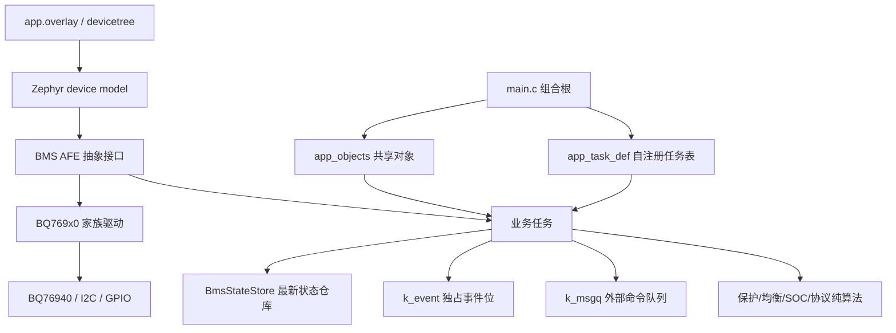
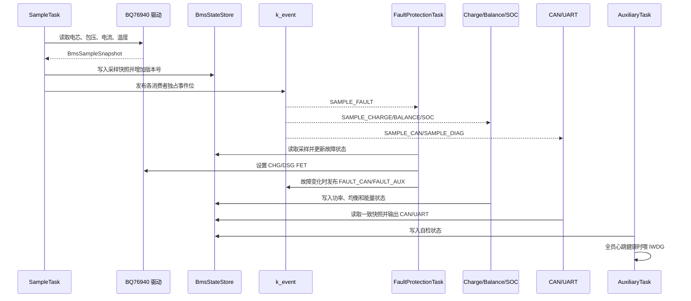
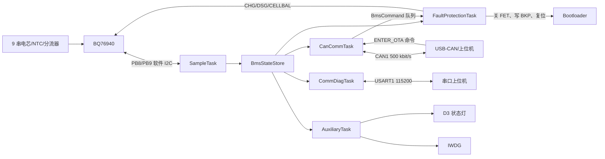

# Flex LoVo BMS 固件

本目录就是完整的 Zephyr 应用工程，可直接作为 `west build` 的应用目录使用，
不再包含额外的 `zephyr/` 子目录。目标硬件为 STM32F103C8T6 + BQ76940，
默认按 9 串实接电芯运行。

## 硬件与软件边界

| 项目 | 当前配置 |
|---|---|
| MCU | STM32F103C8T6，Cortex-M3，64 KiB Flash，20 KiB SRAM |
| AFE | BQ76940，I2C 地址 `0x08`，CRC 开启 |
| 电芯 | 9 串逻辑电芯，映射到 `VC1/2/5/6/7/10/11/12/15` |
| CAN | CAN1，PA11/PA12，500 kbit/s，扩展帧 |
| 诊断串口 | USART1，PA9/PA10，115200 8N1 |
| 状态灯 | D3/PA15，低电平点亮；禁用 JTAG、保留 SWD |
| 真机时钟 | HSE 8 MHz → PLL x9 → 72 MHz |
| 仿真时钟 | HSI 8 MHz，避免依赖 Renode 的 HSE/PLL 模型 |
| RTOS | Zephyr，多线程、事件、消息队列、设备模型 |

板级来源数据见 [`../docs/board-facts/`](../docs/board-facts/)，硬件描述的最终入口是
[`app.overlay`](app.overlay)。

## 目录结构

```text
firmware/
├── CMakeLists.txt            # 源文件清单、包含路径、链接器段登记
├── Kconfig                   # 测试插桩开关
├── prj.conf                  # 公共 Zephyr 配置
├── app.overlay               # 公共板级描述和仿真时钟
├── hw.overlay / hw.conf      # 真机时钟、UART DMA、应用 Flash 偏移
├── sim_hw_i2c.overlay        # Renode 数值回归用硬件 I2C 替代路径
├── test.conf                 # 测试遥测、线程分析和断言
├── test_wdt.conf             # 故意停止喂狗的复位测试配置
├── build.ps1                 # 统一构建入口
├── app_task_iterable.ld      # 自注册任务的 iterable section
├── dts/bindings/             # 自定义 AFE devicetree binding
├── drivers/                  # AFE、NTC 和指示灯驱动
└── src/
    ├── main.c                # 组合根与任务启动
    ├── config/               # 业务配置、事件位和任务注册定义
    ├── core/                 # 状态仓库、心跳和共享对象
    ├── algo/                 # 纯计算策略与协议编解码
    └── tasks/                # 业务线程
```

## 运行环境

构建脚本需要 PowerShell、Python、west、Zephyr 源码树和 GNU Arm Embedded GCC。
当前已验证组合为 Zephyr 4.4.99 开发树与 xPack GCC 15.2.1-1.1。

推荐显式设置环境变量：

```powershell
$env:ZEPHYR_BASE = "C:\zephyr-workspace\zephyr"
$env:GNUARMEMB_TOOLCHAIN_PATH = "C:\Tools\xpack-arm-none-eabi-gcc-15.2.1-1.1"
```

也可设置 `ZEPHYR_WORKSPACE`，脚本会在其下寻找 `zephyr/`。如果都不设置，脚本
依次查找仓库根目录和仓库同级目录下未纳入 Git 的
`Tools/zephyr-workspace/zephyr` 与
`Tools/arm-gcc/xpack-arm-none-eabi-gcc-15.2.1-1.1`。

构建目标板固定为 Zephyr 的 `stm32_min_dev@blue`。在新 Zephyr 版本迁移时，
应先确认该板定义、STM32 时钟 binding 和 CAN/UART 驱动接口没有变化。

## 构建方法

以下命令均从仓库根目录运行。

### 默认仿真构建

```powershell
.\firmware\build.ps1
```

默认配置使用 `app.overlay` 中的 HSI 8 MHz、软件 GPIO I2C 和轮询式 UART 诊断。
输出目录为 `firmware/build/`。

### 真机构建

```powershell
.\firmware\build.ps1 -Hardware
```

真机构建在公共配置上叠加：

- [`hw.overlay`](hw.overlay)：HSE/PLL 72 MHz 与 USART1 TX DMA；
- [`hw.conf`](hw.conf)：`CONFIG_UART_ASYNC_API`、DMA 和 `0x1400` Flash 偏移；
- 独立输出目录 `firmware/build_hw/`，不会覆盖仿真 ELF。

主要产物：

| 文件 | 用途 |
|---|---|
| `build_hw/zephyr/zephyr.elf` | 调试和符号分析 |
| `build_hw/zephyr/zephyr.hex` | 首次 SWD 烧录应用区 |
| `build_hw/zephyr/zephyr.bin` | 生成应用头与 CAN OTA |
| `build_hw/zephyr/zephyr.map` | ROM/RAM 和符号占用分析 |

真机镜像链接地址为 `0x08001400`，必须与
[`../bootloader/bl.h`](../bootloader/bl.h) 的 `APP_BASE_ADDR` 一致。

### 测试插桩构建

```powershell
.\firmware\build.ps1 -TestInstrumentation
.\firmware\build.ps1 -WatchdogExpiryTest
```

第一条启用机器可读遥测、线程分析和栈哨兵；第二条另外故意跳过喂狗，用于
Renode 看门狗复位回归。二者都是测试镜像，不应用于交付。

### 额外 overlay

Renode 数值回归可临时叠加硬件 I2C 节点：

```powershell
$env:BMS_EXTRA_OVERLAY = "sim_hw_i2c.overlay"
.\firmware\build.ps1 -TestInstrumentation
Remove-Item Env:BMS_EXTRA_OVERLAY
```

正式 smoke 脚本会主动清除外部遗留的该变量，保证默认测试仍覆盖软件 I2C 路径。

## 总体架构

工程分为“设备描述、驱动、核心状态、纯算法、任务编排”五层。任务不直接互相
调用，而是通过带互斥保护的最新状态仓库、独占事件位和消息队列协作。



### 依赖装配

1. [`src/main.c`](src/main.c) 调用 `app_objects_init()` 构造共享对象。
2. [`src/core/app_objects.c`](src/core/app_objects.c) 从 devicetree 获取 AFE、CAN、
   UART、WDT 设备，并初始化状态仓库、心跳和策略对象。
3. 每个任务用 [`APP_TASK_REGISTER`](src/config/app_task.h) 把任务元信息放入
   `app_task_def` 链接器段。
4. `main()` 遍历该段，先调用任务的 `bind_fn()` 注入依赖，再创建线程。
5. `main()` 返回，业务全部由线程接管。

新增任务不需要修改 `main.c`，但必须在 [`CMakeLists.txt`](CMakeLists.txt) 登记源文件，
实现 `bind`、线程入口和一次 `APP_TASK_REGISTER`。

### 中心状态仓库

[`BmsStateStore`](src/core/bms_state_store.h) 保存采样、故障、功率、能量、均衡和
自检的最新快照。每类状态独立计数版本号，写入在互斥锁内完成；消费者用版本号
跳过重复快照。仓库只保证一致性，不负责业务判断。

## 任务与优先级

Zephyr 抢占优先级数字越小越高。周期、栈和开关集中在
[`src/config/appconfig.h`](src/config/appconfig.h)。

| 任务 | 优先级 | 栈 | 触发 | 职责 |
|---|---:|---:|---|---|
| [`FaultProtectionTask`](src/tasks/fault_protection_task.c) | 0 | 640 B | 采样事件或 300 ms 超时 | 去抖、回差、故障锁存、FET 唯一仲裁、OTA 安全入口 |
| [`SampleTask`](src/tasks/sample_task.c) | 2 | 768 B | 100 ms 绝对时间周期 | 读取 AFE 电芯/包压/电流/温度并发布采样快照 |
| [`ChargeStateTask`](src/tasks/charge_state_task.c) | 3 | 640 B | 新采样 | 充电/放电/静置/故障分类并记录 FET 实际状态 |
| [`BalanceTask`](src/tasks/balance_task.c) | 4 | 640 B | 新采样 | 计算被动均衡位图并写入 CELLBAL |
| [`SocEnergyTask`](src/tasks/soc_energy_task.c) | 5 | 512 B | 新采样 | OCV 初始化、库仑积分、SOC/SOH/SOP 更新 |
| [`CanCommTask`](src/tasks/can_comm_task.c) | 6 | 768 B | 事件或 100 ms 超时 | 7 帧遥测、命令 RX 入队、异步 CAN TX |
| [`CommDiagTask`](src/tasks/comm_diag_task.c) | 7 | 640 B | 采样事件或 50 ms 超时 | UART SNAP、AFE 寄存器转储和命令接收 |
| [`AuxiliaryTask`](src/tasks/auxiliary_task.c) | 8 | 1024 B | 故障事件或 500 ms 周期 | 心跳巡检、状态灯、自检状态、健康喂狗 |

`CommDiagTask` 是 bring-up 诊断任务，不计入七个业务任务。所有已启用任务均由
编译期功能开关裁剪；AuxiliaryTask 只巡检实际启用任务的心跳槽位。

## 一次采样周期的任务流程



事件位分配见 [`src/config/bms_events.h`](src/config/bms_events.h)。每个消费者只等待
并清除自己的位，避免多个任务共享同一位造成漏处理或退化为轮询。

## 通信与硬件数据流



### CAN 应用协议

应用发送扩展帧 `0x0001` 到 `0x0007`，DLC 8，`byte0=0xAA`，
`byte1=帧号`，16 位字段使用大端。完整字段来源在
[`docs/board-facts/can_protocol.json`](../docs/board-facts/can_protocol.json)，编解码实现
位于 [`bms_protocol_codec.c`](src/algo/bms_protocol_codec.c)。

| ID | 数据 |
|---:|---|
| `0x0001`～`0x0005` | 每帧 3 个 BQ76940 物理 VC 槽位电压，未接槽位填 0 |
| `0x0006` | 包压、SOC、电流 |
| `0x0007` | 温度、DSG 状态、CHG 状态 |
| `0x0100` | 上位机命令：`A5 01` 清故障，`A5 02` 进入 OTA |

CAN RX 回调只用 `K_NO_WAIT` 投递原始帧，命令解码和业务处理在任务上下文完成。

### UART 诊断协议

固件启动后输出 `BMS UART diag ready. Send S for snapshot.`。命令不需要回车：

| 命令 | 行为 |
|---|---|
| `S` / `s` | 输出一帧 `SNAP` 状态快照 |
| `R` / `r` | 依次读取并输出 AFE `0x00..0x59` 寄存器 |
| 其他非空白字符 | 返回 `ERR command` |

真机构建使用 UART TX DMA；Renode 构建因无 DMA 模型而退回 `uart_poll_out`。
接收仍使用非阻塞 `uart_poll_in`，由 50 ms 超时保证无新采样时也能处理命令。

## 保护与 OTA 入口

[`FaultProtectionTask`](src/tasks/fault_protection_task.c) 是 CHG/DSG FET 的唯一仲裁者。
保护策略见 [`bms_protection_policy.c`](src/algo/bms_protection_policy.c)，阈值和去抖时间
见 [`appconfig.h`](src/config/appconfig.h)。

收到 `ENTER_OTA` 后执行：

1. 强制关闭 CHG 和 DSG；
2. 回读开关状态，失败时短延时重试；
3. 如果仍无法确认双 FET 已关闭，则拒绝进入 OTA；
4. 写入 BKP 备份寄存器魔数 `0x4F54` 并回读确认；
5. 冷复位，由 Bootloader 识别标志并进入 CAN 升级。

Bootloader 协议和恢复策略见 [`../bootloader/README.md`](../bootloader/README.md)。

## 驱动设计

[`drivers/afe/bms_afe.h`](drivers/afe/bms_afe.h) 定义 AFE 虚表，按量测、保护、均衡和
功率执行器拆分能力组。应用任务只依赖 `const struct device *` 和统一分发函数。

- [`bq769x0_core.c`](drivers/afe/bq769x0_core.c)：BQ76930/BQ76940 共用寄存器、CRC、
  电压/电流换算和 FET/均衡实现；
- [`bms_bq76940.c`](drivers/afe/bms_bq76940.c)：认领 `bms,bq76940` compatible；
- [`bms_bq76930.c`](drivers/afe/bms_bq76930.c)：同家族低串数薄封装；
- [`bms_bq79616.c`](drivers/afe/bms_bq79616.c)：差分 UART 菊链接口骨架，尚未完成；
- [`bms_ntc.c`](drivers/sensor/bms_ntc.c)：NTC 分压到温度换算，与 AFE 传输解耦；
- [`bms_status_led.c`](drivers/indicator/bms_status_led.c)：状态级别到 GPIO/PWM 的渲染。

设备型号、I2C 传输和电芯映射由 devicetree 决定。更换同接口 AFE 时，优先新增
compatible、binding 和驱动实现，不应把芯片判断写入业务任务。

## 配置方法

### 业务配置

[`src/config/appconfig.h`](src/config/appconfig.h) 是业务参数唯一入口，包括：

- 功能开关；
- 100 ms 采样、100 ms CAN、500 ms 辅助任务周期；
- 任务优先级和静态栈；
- OV/UV、充放电温度、过流的触发与恢复阈值；
- SOC 容量、OCV 校准、积分断档处理；
- 均衡压差、最低电压和电流窗口；
- 心跳、看门狗和低电量灯阈值。

### 平台配置

| 文件 | 应放内容 |
|---|---|
| [`prj.conf`](prj.conf) | Zephyr 子系统、内核栈、libc、看门狗等平台能力 |
| [`app.overlay`](app.overlay) | 引脚、地址、时钟、外设、AFE 通道等硬件事实 |
| [`hw.conf`](hw.conf) | 仅真机需要的 Kconfig 差异 |
| [`hw.overlay`](hw.overlay) | 仅真机需要的时钟和 DMA 描述 |
| [`test.conf`](test.conf) | 仅测试需要的可观测性和断言 |

业务阈值不要放进 devicetree，硬件引脚和地址也不要写进业务 C 文件。

## 代码阅读顺序

第一次阅读建议按下面顺序，能最快建立“启动、数据、策略、硬件”的完整链路：

1. [`app.overlay`](app.overlay)：先确认板上有哪些设备以及 9 串如何映射。
2. [`src/config/appconfig.h`](src/config/appconfig.h)：了解周期、优先级和保护阈值。
3. [`src/main.c`](src/main.c)：理解组合根如何构造、绑定并启动任务。
4. [`src/config/app_task.h`](src/config/app_task.h)：理解链接器段自注册机制。
5. [`src/core/app_objects.c`](src/core/app_objects.c)：查看共享设备和业务对象如何装配。
6. [`src/tasks/sample_task.c`](src/tasks/sample_task.c)：沿硬件到状态仓库的数据入口阅读。
7. [`src/core/bms_state_store.h`](src/core/bms_state_store.h) 与
   [`src/config/bms_events.h`](src/config/bms_events.h)：理解任务间通信。
8. [`src/tasks/fault_protection_task.c`](src/tasks/fault_protection_task.c) 与
   [`src/algo/bms_protection_policy.c`](src/algo/bms_protection_policy.c)：理解安全主链路。
9. 依次阅读 [`charge_state_task.c`](src/tasks/charge_state_task.c)、
   [`balance_task.c`](src/tasks/balance_task.c)、[`soc_energy_task.c`](src/tasks/soc_energy_task.c)。
10. 阅读 [`can_comm_task.c`](src/tasks/can_comm_task.c)、
    [`comm_diag_task.c`](src/tasks/comm_diag_task.c) 和协议编解码。
11. 最后进入 [`drivers/afe/bms_afe.h`](drivers/afe/bms_afe.h) 与
    [`drivers/afe/bq769x0_core.c`](drivers/afe/bq769x0_core.c) 看硬件细节。

调试具体问题时反向阅读：从错误输出或任务入口开始，经过状态仓库/策略，最后落到
AFE 分发函数和寄存器实现。

## 烧录与运行

真机固件必须配合本仓库 Bootloader：

1. 运行 `build.ps1 -Hardware`；
2. 使用 `zephyr.bin` 生成应用头；
3. 首次通过 SWD 分别写入 Bootloader、应用头和应用镜像；
4. 复位后 Bootloader 校验 CRC 并跳到 `0x08001400`；
5. USART1 应输出诊断 banner，发送 `S` 应得到 SNAP；
6. CAN 总线上应每 100 ms 看到一组 `0x0001..0x0007` 扩展帧。

完整命令见 [`../bootloader/README.md`](../bootloader/README.md#首次-swd-烧录)。

## 测试

```powershell
.\tests\renode\run_zephyr_bms_smoke.ps1
.\tests\renode\run_zephyr_uart_rx_test.ps1
.\tests\renode\run_zephyr_wdt_reset_test.ps1
.\tests\renode\run_zephyr_stress_test.ps1
```

Renode 脚本会按需要重新构建测试镜像。场景写法、参数和结果目录见
[`../tests/README.md`](../tests/README.md) 与
[`../tests/renode/README.md`](../tests/renode/README.md)。

## 修改后的最低验证

| 修改范围 | 最低验证 |
|---|---|
| 文档、路径或构建脚本 | PowerShell 语法解析、默认构建命令路径检查 |
| 纯算法或协议 | 固件构建、相关单元/场景、Python 解析测试 |
| 任务、事件或状态仓库 | 固件构建、全部 smoke、压力和看门狗测试 |
| AFE、保护、FET 或 Flash 偏移 | 全部仿真回归 + 真机限流验证 + SWD 可恢复性确认 |
| OTA 入口 | 双 FET 回读、BKP 标志、失败留 Bootloader、CRC 错误重传测试 |

Renode 不能证明模拟测量精度、真实 I2C 时序、CAN 收发器、功率 FET 或 EMC 行为。
涉及这些边界的修改必须补充真机验证记录。
