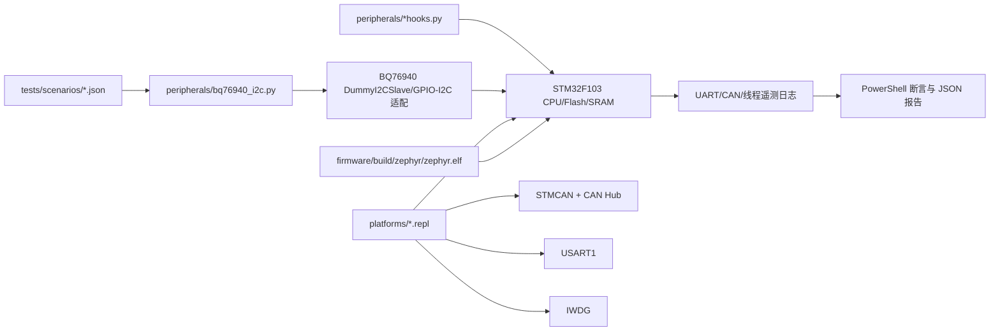

# Renode 测试平台

Renode 是可脚本化的嵌入式系统仿真器。本目录用它加载真实 Zephyr ELF，在没有
STM32F103 板卡、BQ76940、USB-CAN 和串口线的情况下执行固件回归。

## 平台组成



### 文件分工

| 路径 | 作用 |
|---|---|
| [`platforms/bms_stm32f103_bq76940_addons.repl`](platforms/bms_stm32f103_bq76940_addons.repl) | 在 Renode 自带 STM32F103 平台上增加 CAN1、IWDG 和板级部件 |
| [`peripherals/bq76940_i2c.py`](peripherals/bq76940_i2c.py) | 把场景转换为 BQ76940 寄存器，并适配硬件/软件 I2C 访问 |
| [`peripherals/firmware_smoke_hooks.py`](peripherals/firmware_smoke_hooks.py) | 启动向量、CAN 观察和 smoke 辅助命令 |
| [`peripherals/uart_smoke_hooks.py`](peripherals/uart_smoke_hooks.py) | 解析 UART SNAP 并执行场景断言 |
| [`../scenarios/`](../scenarios/) | 电池电压、电流、温度和 NTC 输入 |
| `artifacts/` | 临时脚本、日志、抓包和报告，运行时创建 |

## 环境准备

1. 安装 Renode 1.16 或兼容版本。
2. 配置固件构建所需的 `ZEPHYR_BASE` 和 `GNUARMEMB_TOOLCHAIN_PATH`。
3. Renode 不在默认路径时设置 `BMS_RENODE_PATH`，或向脚本传 `-RenodePath`。

```powershell
$env:BMS_RENODE_PATH = "D:\Tools\Renode\bin\Renode.exe"
$env:ZEPHYR_BASE = "C:\zephyr-workspace\zephyr"
$env:GNUARMEMB_TOOLCHAIN_PATH = "C:\Tools\xpack-arm-none-eabi-gcc-15.2.1-1.1"
```

## 现有测试

| 脚本 | 验证内容 |
|---|---|
| [`run_zephyr_bms_smoke.ps1`](run_zephyr_bms_smoke.ps1) | 主入口，调用 UART smoke 的全部场景 |
| [`run_zephyr_uart_smoke.ps1`](run_zephyr_uart_smoke.ps1) | 启动、BQ 采样、故障、均衡、CAN 字段与 UART SNAP |
| [`run_zephyr_uart_rx_test.ps1`](run_zephyr_uart_rx_test.ps1) | 无效字符、`S` 快照、`R` 寄存器命令路径 |
| [`run_zephyr_wdt_reset_test.ps1`](run_zephyr_wdt_reset_test.ps1) | IWDG 建立、停止喂狗和复位后重新启动 |
| [`run_zephyr_stress_test.ps1`](run_zephyr_stress_test.ps1) | 线程栈、采样节拍、调度延迟、CAN 与看门狗喂狗间隔 |
| [`run_bq_i2c_smoke.ps1`](run_bq_i2c_smoke.ps1) | 不运行固件，单独验证 BQ 寄存器模型 |
| [`run_bq_gpio_i2c_smoke.ps1`](run_bq_gpio_i2c_smoke.ps1) | 单独验证 GPIO 位翻转 I2C 协议适配 |

## 常用命令

### 全部主场景

```powershell
.\tests\renode\run_zephyr_bms_smoke.ps1
```

该入口当前依次执行 `normal`、`overvoltage`、`balance`、`undervoltage`、
`ntc_open` 和 `ntc_short` 场景，并默认启用 Renode 1.16 的 STM32F1 CAN 初始化
兼容处理。已替换为修复后的 STMCAN 模型时，可直接运行下层脚本而不带兼容参数。

### 只运行一个场景

```powershell
.\tests\renode\run_zephyr_uart_smoke.ps1 -Scenario overvoltage
.\tests\renode\run_zephyr_uart_smoke.ps1 -Scenario balance -DurationSeconds 2.0
.\tests\renode\run_zephyr_uart_smoke.ps1 -Scenario normal -CanInitWorkaround
```

`-Scenario` 可选值：`all`、`normal`、`overvoltage`、`balance`、
`undervoltage`、`ntc_open`、`ntc_short`。

Renode 1.16 自带 STMCAN 模型在 STM32F1 初始化顺序上会让 `can_start()` 返回
`-ENODEV`。直接调用下层脚本时加 `-CanInitWorkaround`；主入口已经自动添加。

### 复用已有 ELF

```powershell
.\firmware\build.ps1 -TestInstrumentation
.\tests\renode\run_zephyr_uart_smoke.ps1 -Scenario normal -SkipBuild
```

只有确认 ELF 的配置与当前测试一致时才使用 `-SkipBuild`。看门狗过期测试需要
`-WatchdogExpiryTest` 构建，不能误用普通测试 ELF。

### CAN 调试与抓包

```powershell
.\tests\renode\run_zephyr_uart_smoke.ps1 -Scenario normal -TraceCan
.\tests\renode\run_zephyr_uart_smoke.ps1 -Scenario normal -CaptureCan
```

`-TraceCan` 记录 CAN 控制器寄存器访问；`-CaptureCan` 通过 Renode CAN hub 启动
Wireshark 抓取真实虚拟总线帧。抓包要求 Wireshark 已安装，细节见
[`CAN_CAPTURE.md`](CAN_CAPTURE.md)。固件的 `BMS_CAN_TX` 文本遥测只是发送调用记录，
不能等同总线抓包。

### 其他回归

```powershell
.\tests\renode\run_zephyr_uart_rx_test.ps1
.\tests\renode\run_zephyr_wdt_reset_test.ps1
.\tests\renode\run_zephyr_stress_test.ps1 -DurationSeconds 3.0
.\tests\renode\run_bq_i2c_smoke.ps1
```

## 一个测试如何运行

以 [`run_zephyr_uart_smoke.ps1`](run_zephyr_uart_smoke.ps1) 为例：

1. 解析仓库根、Renode 路径、场景和输出目录；
2. 调用 [`firmware/build.ps1`](../../firmware/build.ps1) 生成测试插桩 ELF；
3. 动态生成 `.resc`，装载 Renode 自带 STM32F103 CPU 平台和本项目 `.repl`；
4. 创建 BQ76940 模型、CAN hub 和 UART 文件后端；
5. 加载 ELF，从向量表启动并推进指定虚拟时间；
6. 模型把场景电压、电流和温度转换为 BQ 寄存器值；
7. 固件输出 UART SNAP、CAN 发送记录、线程和看门狗遥测；
8. Python hook 与 PowerShell 检查数值、故障、FET、均衡和时序；
9. 日志和报告保存在 `artifacts/`。

## 编写新场景

复制最接近的 [`../scenarios/normal_15s_shipping.json`](../scenarios/normal_15s_shipping.json)，
修改以下字段：

| 字段 | 说明 |
|---|---|
| `name` | 场景唯一名称 |
| `cell_count` | BQ 物理槽位数，当前固定 15 |
| `active_cell_channels` | 实接槽位，当前固定 1/2/5/6/7/10/11/12/15 |
| `cell_mv` | 15 个槽位电压，未接槽位填 0 |
| `current_ma` | 放电为正，充电为负 |
| `temperatures_c` | TS 通道温度列表 |
| `ntc` | R25、Beta 和上拉电阻 |
| `protection_thresholds` | 场景说明与断言使用的参考阈值 |

然后在 `run_zephyr_uart_smoke.ps1` 的 `ValidateSet` 和场景映射中登记名称，并增加
明确的预期值。保护测试至少断言：故障位、`latched`、CHG/DSG 允许状态和实际 FET；
均衡测试至少断言请求位图和已应用位图。

## 编写新 Renode 测试

### 只测外设模型

可从 [`bms_bq_i2c_smoke.resc`](bms_bq_i2c_smoke.resc) 开始：

```text
mach create "my-test"
machine LoadPlatformDescription @platforms/cpus/stm32f103.repl
machine LoadPlatformDescription @platforms/bms_stm32f103_bq76940_addons.repl
machine LoadPlatformDescriptionFromString "bq76940: Mocks.DummyI2CSlave @ i2c1 0x08"
include @peripherals/bq76940_i2c.py
setup_bq76940_i2c "sysbus.i2c1.bq76940" "../scenarios/normal_15s_shipping.json"
```

随后调用模型提供的自检命令，或在 Python 外设模型中新增一个范围明确的 Monitor
命令。模型修改应保持寄存器语义和场景转换分离。

### 测完整固件

建议复制现有 PowerShell runner，并只修改测试特有部分：

1. 使用唯一的日志、临时 `.resc` 和报告文件名；
2. 选择 `-TestInstrumentation` 或 `-WatchdogExpiryTest`；
3. 装载 `firmware/build/zephyr/zephyr.elf`；
4. 使用虚拟时间 `emulation RunFor`，避免依赖主机墙钟；
5. 关闭 UART 文件后端后再读取日志；
6. 对业务结果做显式断言，失败时抛出包含场景和实际值的错误；
7. 确保失败路径给调用者返回非零退出码。

PowerShell 5.1 对无 BOM 脚本使用系统代码页读取。现有 Renode runner 保持 ASCII，
新增脚本也应遵循该约束，或明确保存为带 BOM 的 UTF-8。

## 输出与排错

常见输出位于：

```text
tests/renode/artifacts/
├── zephyr_uart*.log
├── zephyr_renode*.log
├── *.resc
├── *.json
└── *.pcapng（启用抓包时）
```

排错顺序：

1. 先看 PowerShell 最后的断言错误；
2. 查看 UART 日志是否出现启动 banner 和 SNAP；
3. 查看 Renode 控制台日志是否有未映射外设、异常 PC 或模型异常；
4. CAN 初始化问题用 `-TraceCan`，总线帧问题用 `-CaptureCan`；
5. 核对测试使用的 ELF 是否由正确配置刚刚生成；
6. 仍无法解释时，缩短为单场景并提高对应外设日志级别。

已知 STMCAN F1 模型问题的分析记录见
[`RENODE_STMCAN_F1_BXCAN_INIT_BUG.md`](RENODE_STMCAN_F1_BXCAN_INIT_BUG.md)。

## 仿真假设

- 默认固件使用 GPIO 软件 I2C；Renode 通过适配层观察 PB8/PB9 事务并连接脚本化 BQ 模型。
- `sim_hw_i2c.overlay` 只用于传输无关的数值回归，不代表真机最终连接。
- Renode 不完整模拟 HSE/PLL 和 STM32F1 DMA，所以仿真构建使用 HSI 与轮询 UART。
- STMCAN、IWDG 和 GPIO 模型的通过只能证明模型内行为，不等同于真机时序认证。
- 测试场景当前是静态输入，不覆盖电池化学动态、负载瞬态或热耦合。
